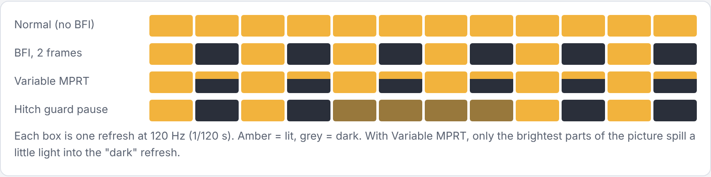
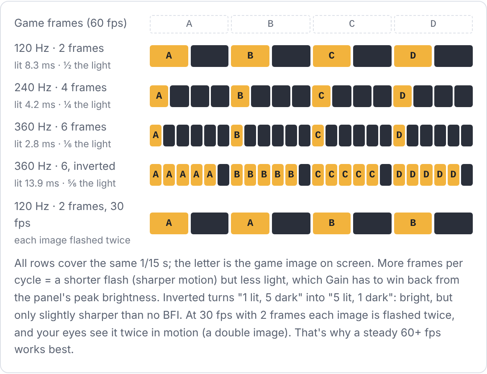
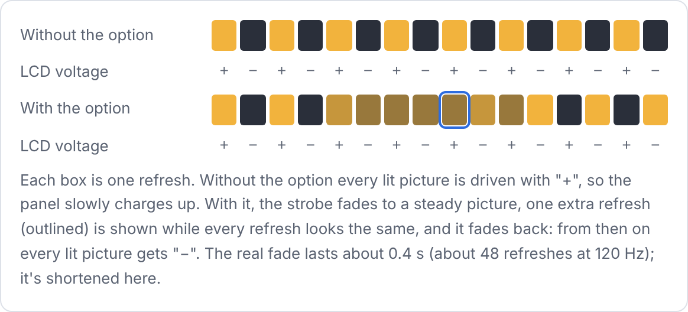
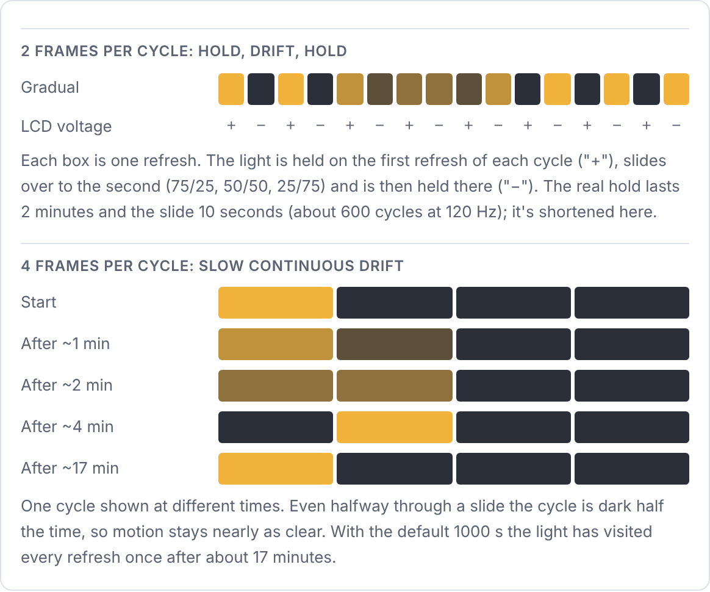
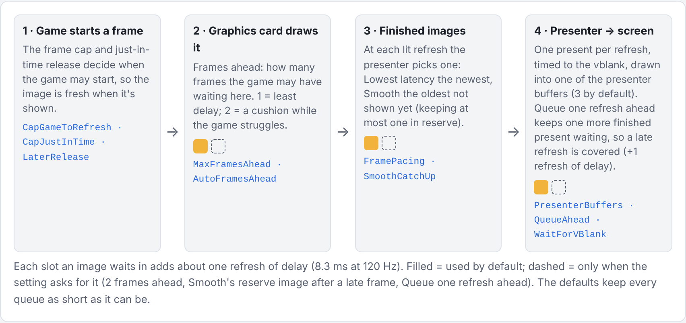
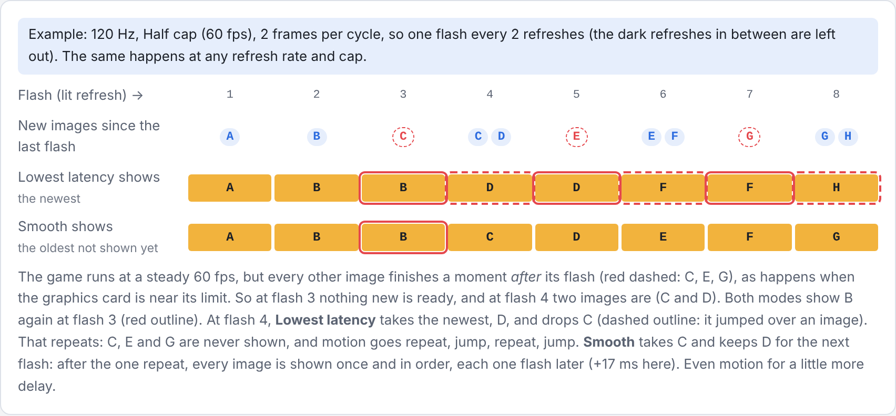
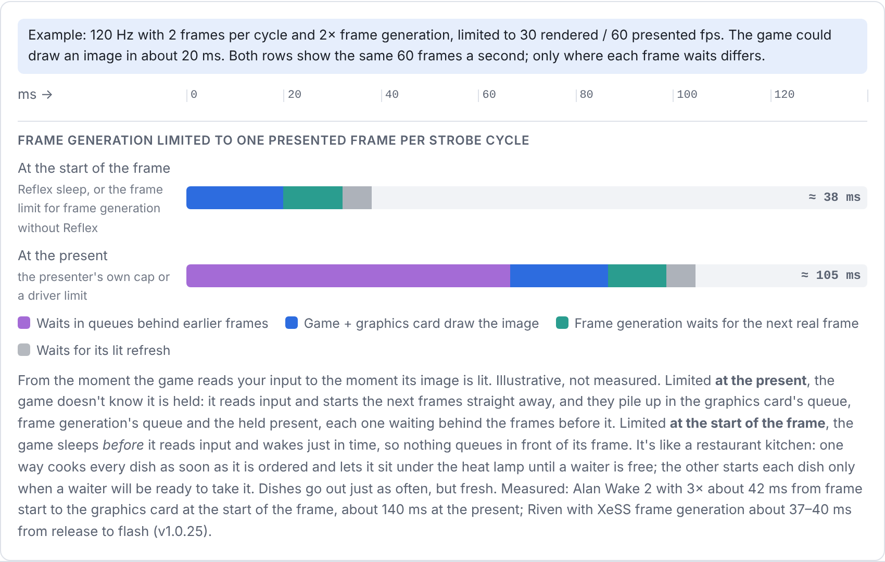

# BFI Presenter Settings Guide

What each option in the BFI Presenter window (and in `BFIPresenter.ini`) does, in plain words, for people who just want sharper motion and don't care how a GPU works. Each entry says what it is, what you'd notice, and when it's worth touching. Most people only ever need the first two sections.

**Contents:** [The idea in one minute](#the-idea-in-one-minute) · [The strobe](#the-strobe) · [Rolling scan](#rolling-scan) · [Your display](#your-display) · [Smoothness and latency](#smoothness-and-latency) · [Safety nets](#safety-nets) · [Compatibility switches](#compatibility-switches) · [Vulkan only](#vulkan-only) · [Logs](#logs) · [Hotkeys](#hotkeys) · [Good starting points](#good-starting-points)

Each entry shows the setting's name in the overlay, its key in `BFIPresenter.ini` and its default.

## The idea in one minute

An OLED or LCD keeps each picture lit for the whole time until the next one arrives. Your eyes follow moving things smoothly, but the picture on screen jumps in steps, so everything in motion smears. CRT displays didn't have this problem because each picture only flashed briefly.

BFI Presenter brings the flash back. At 120 Hz your screen shows 120 pictures a second; BFI Presenter makes one of them bright and the next one dark, over and over. The game still shows 60 new images a second, but each one is only visible for half the time, so motion looks about twice as sharp. The price is brightness (half the light) and a 60 Hz flicker some people notice.

<picture>
  <source media="(prefers-color-scheme: dark)" srcset="img/bfi-refreshes-dark.png">
  
</picture>

Everything below is a way of tuning that flash: how bright it is, how it handles highlights, and how BFI Presenter keeps the game in step with it.

## The strobe

**BFI enabled** · `Enabled` · default: on\
The main switch. Off, BFI Presenter still shows the game but without any dark frames, so you can compare.\
*When to change it:* use the hotkey Ctrl+Shift+B to flip it during play and see the difference.

**Method** · `Method` · default: Variable MPRT
- **BFI** makes the dark refresh truly black. Sharpest motion, but the picture loses half its light, and very bright areas have nowhere to go, so they get gently squashed.
- **Variable MPRT** works like a brightness budget: dark and mid-tones flash exactly like BFI, but anything too bright to fit in one flash borrows a bit of the dark refresh. You keep bright highlights at the cost of slightly less sharpness in only those bright parts. Think of it as "BFI where it's free, a little less where it would cost you brightness."

*When to change it:* Variable MPRT is the better default, especially in HDR. Try BFI if you want the crispest possible motion and don't mind a dimmer picture. Hotkey: Ctrl+Shift+M.

**Frames per cycle** · `Frames` · default: 2\
How many refreshes make up one flash cycle: 2 means "one lit, one dark". 3 or 4 means one lit and two or three dark, which is even sharper but darker, and flickers at a lower rate.\
*When to change it:* keep 2 at 120 Hz. Higher values are for 240 Hz+ displays; pair them with the **One game frame per strobe cycle** frame cap, so each game image gets exactly one flash.

> **The formula:** strobe rate = your refresh rate ÷ frames per cycle. For a new image on every flash, the game needs at least that many fps. With frame generation, count the **final** fps, generated frames included: the presenter sees every presented frame the same way.
> E.g. 120 Hz ÷ 2 = 60 fps · 240 Hz ÷ 2 = 120 fps (e.g. 60 real ×2 frame generation, or 40 real ×3) · 360 Hz ÷ 6 = 60 fps.
> Prefer a higher frame-generation factor over more frames per cycle: e.g. at 240 Hz, 40 real ×3 at 2 frames (a 120 Hz strobe) beats 40 real ×2 at 3 frames (an 80 Hz strobe, more flicker).

<picture>
  <source media="(prefers-color-scheme: dark)" srcset="img/frames-per-cycle-dark.png">
  
</picture>

**Gain vs blur** · `Gain` · default: 0.5 (recommended 1.0)\
How much of the lost brightness to win back. At 0.5 the lit frame looks exactly like the normal picture, so the overall image is half as bright. At 1.0 the lit frame is boosted to make up the difference, so the average brightness is close to normal.\
*When to change it:* use 1.0 on bright displays (most OLEDs in HDR). With the **ABL guard** on and its budget set to your panel's full-white brightness, bright scenes stay steady at 1.0. Lower it only if the screen still dims in bright scenes (ABL guard off, or its budget set too high), or in SDR, where there is little room above white and bright highlights get compressed and look flat.

**Dark frame floor** · `DarkFloor` · default: 0\
How dark the dark refresh is. 0 is pure black. Raising it leaves a faint copy of the picture in the dark refresh: less flicker, a bit more blur.\
*When to change it:* raise to 0.05–0.15 only if the flicker bothers you.

**Highlight roll-off** and **knee** · `HighlightRolloff`, `RolloffKnee` · default: on, 0.75\
BFI method only. When the boosted lit frame can't get any brighter, the brightest areas would clip into flat white blobs and shift colour. Roll-off eases them in smoothly instead, keeping their colour. The knee is where the easing starts: lower means it starts earlier and is gentler.\
*When to change it:* leave it on. Lower the knee a little if bright skies or lamps look flat.

**Sine BFI** · `SineBFI` · default: off\
Instead of a hard on/off, the brightness rises and falls in a soft wave across the cycle. Softer flicker, slightly more blur. Mostly useful with 3 or more frames per cycle.

**Invert cycle** · `InvertCycle` · default: off\
With 3+ frames per cycle, flips the pattern to "lit, lit, dark" instead of "lit, dark, dark". Brighter and less flicker, less sharpness gain. Does nothing at 2 frames.

## Rolling scan

A CRT didn't flash the whole screen at once: a beam drew it line by line from top to bottom. Rolling scan imitates that by lighting the screen in horizontal bands, one after another.

**Rolling scan** · `RollingScan` · default: off\
Lights the screen band by band instead of all at once. Because part of the screen is always lit, the flicker feels much calmer.\
*When to change it:* really meant for 240 Hz+ displays (4 bands). At 120 Hz there are only two halves, with a visible seam in the middle. Hotkey: Ctrl+Shift+S.

**Seam** · `RollingSeam` · default: 0 (hard edge)\
Only with phosphor decay at 0. How wide the blended zone is where two bands meet, as a share of the screen height. Wider hides the edge better, but pixels in the zone are lit in both bands' refreshes, so the seam blurs visibly in motion.\
*When to change it:* rarely; maybe in a very static game. Phosphor decay hides the edge without that blur.

**Phosphor decay** · `RollingPhosphorDecay` · default: 0.2\
Makes each line fade out after the "beam" passes, like the glow of a real CRT, instead of switching off sharply. No seam at all, smoother and less flickery, slightly more blur.\
*When to change it:* 0.2–0.4 works well; 0 switches it off and gives hard bands with the seam above.

**Split comparison** · `SplitCompare` · default: off\
Shows one side of the screen without BFI and the other with it, at the same brightness, so the difference in motion is visible in one picture: pan the camera and compare the two halves. The side without BFI shows every refresh at the light the strobe gives over its cycle, after highlight roll-off and the panel ceiling, so the halves differ only in motion clarity and flicker. It also shows the game's frames as a display without BFI would: the newest one at every refresh. When the game runs faster than the strobe cycle (e.g. 120 fps at 120 Hz with 2 frames per cycle), the side without BFI shows all 120 frames a second, while the BFI side shows one per strobe cycle (60) and drops the rest, so the comparison is BFI against the game at its full frame rate (v1.0.38; before, both sides showed the same 60). At Half refresh both sides show the same 60 frames. **Without BFI** picks the side, **Seam position** where the halves meet (percent of the width) and **Seam softness** a soft edge in pixels. Works in every API, DirectX and Vulkan. The idea comes from [unrefined803](https://github.com/unrefined803)'s demo ([#111](https://github.com/artzox/BFI-Presenter/pull/111)).\
*When to change it:* for videos, streams and showing someone what BFI does. Hotkey: Ctrl+Shift+C. Turn it off for playing.

**On-screen display** · `Osd`, `OsdCorner`, `OsdGraph`, `OsdLoads`, `OsdScale` · default: off, top right, on, on, 1.0\
A small panel over the game, so you can watch it while changing the game's settings, without RTSS and without opening ReShade's menu: the game's frame rate and frame time (green at one game frame per strobe cycle or more, amber or red below), the refresh rate and strobe cycles per second, the presenter's **lost** frames (finished but never shown), **repeated** frames (strobe cycles that showed the previous frame again) and **missed** refreshes, each for the last second, with totals in brackets since you last reset them (Ctrl+Shift+Z, or **Reset totals** next to the checkbox; the time they cover is shown under them), a frame-time graph of the last 240 game frames, and CPU and GPU load (GPU load on NVIDIA cards, through the driver's NVML). It is drawn into the game's picture through ReShade, so it flashes with BFI like the rest of the image. Corner, graph, loads and size can be set. Works in every API, DirectX and Vulkan (v1.0.38). Since v1.0.50 it also shows the game's **video memory** against what Windows gives it, e.g. "video memory 12.9 of 13.8 GB (BFI Presenter 0.8, CRT hand-off 0.3)": green, amber within 0.5 GB of the budget, red over it. Over it, part of the game's memory is moved to system memory and the GPU stalls now and then (missed refreshes, BFI pauses); lower the game's texture or memory settings. In the Vulkan layer it shows the game's use and the budget, without BFI Presenter's share.\
*When to change it:* turn it on while tuning a game's settings. Hotkey: Ctrl+Shift+F. To compare two settings, reset the totals after each change and play the same stretch.

## Your display

**LCD: prevent image retention** · `LcdPhaseSwap` · default: off\
**Turn this on if you have an LCD monitor (IPS, VA or TN).** An LCD drives every refresh with the opposite voltage of the one before, so over time it all evens out. With BFI's "lit, dark, lit, dark" every lit picture lands on the same voltage, and after a long session the screen can keep a faint ghost of the image (HUDs, menus). It's usually temporary, but annoying. The fix is to move the lit picture to the other refresh from time to time, so the lit pictures get the other voltage for a while and it evens out. There are two ways to do that, picked with **Mode**.\
*When to change it:* on for every LCD; leave off for OLED, which doesn't work this way. Not needed with an odd number of frames per cycle (3, 5, 7), where the lit refresh alternates anyway.

**Mode** · `LcdSaverGradual` · default: Immediate (0)\
How the lit picture is moved to the other refresh.

- **Immediate** (0): every few seconds the flashing fades out to a steady picture (about half a second), shifts by one refresh where nobody can see it, and fades back in. Quick and well tested, but each swap shows as a short softening of motion, and some people notice a small stutter.
- **Gradual** (1): the lit picture slides slowly from one refresh into the next instead of jumping, with no fade and no stutter. How it slides depends on the frames per cycle, below.

*When to change it:* try Gradual if the Immediate swaps bother you. Gradual works with the plain strobe (BFI or Variable MPRT) only; with Sine BFI, Invert cycle or Rolling scan on, Immediate is used.

**Immediate: seconds between swaps** · `LcdPhaseSwapSeconds` · default: 5\
How long the full strobe runs between two swaps (1–300).\
*When to change it:* lower it if you still see a ghost. One IPS tester still saw one at 30 s; at 5 s it was gone.

<picture>
  <source media="(prefers-color-scheme: dark)" srcset="img/lcd-phase-swap-dark.png">
  
</picture>

**How Gradual moves the light.** Think of each refresh in a cycle as a chair, and the lit picture as a spotlight on one chair. Gradual slides the spotlight to the next chair instead of switching it off and on again. While it slides, part of the light is on one refresh and the rest on the next; the total light in the cycle never changes, so nothing flickers or changes brightness.

The catch is that while the light is split, the picture is lit for longer, and longer means more motion blur. How much depends on how many refreshes the cycle has:

- **2 frames per cycle (e.g. 60 fps at 120 Hz):** halfway through a slide the light is split 50/50 over both refreshes. That's the same as no BFI at all for that moment, so motion clearly softens. So at 2 frames Gradual **holds, drifts, holds**: the light stays fully on one refresh for 2 minutes (sharp, just like with the option off), slides to the other refresh over 10 seconds, and stays there for the next 2 minutes. You're in a slide only about 8% of the time, and noticeably soft for about half of that.
- **4 or more frames per cycle (e.g. 60 fps at 240 Hz):** halfway through a slide the cycle is still something like 50%, 50%, 0%, 0%, so it's dark half the time and motion stays nearly as clear. Here Gradual slides **continuously and very slowly**: by default once through the whole cycle every 1000 seconds (about 17 minutes), about 4 minutes per refresh. Changes that slow are very hard to see.

<picture>
  <source media="(prefers-color-scheme: dark)" srcset="img/lcd-gradual-dark.png">
  
</picture>

**Gradual at 2 frames: hold seconds** · `LcdGradualHoldSeconds` · default: 120\
How long the light stays fully on one refresh before it slides to the other (0–600). 0 = no holds: slide continuously, using the seconds per full drift below.\
*When to change it:* if you see a ghost image, lower it (e.g. 30, or 20 for a very sensitive panel). Each hold puts the lit pictures on one voltage, like the time between Immediate swaps, and one IPS tester saw a ghost with Immediate swaps every 30 s. Shorter holds mean slides come more often.

**Gradual at 2 frames: drift seconds** · `LcdGradualDriftSeconds` · default: 10\
How long one slide to the other refresh takes (2–60).\
*When to change it:* longer (20–30) if you notice the slide as a change in clarity; it becomes gentler, but the picture is soft for longer. Shorter gets it over with, but the change becomes easier to see.

**Gradual at 4+ frames: seconds per full drift** · `LcdGradualSeconds` · default: 1000\
How long the light takes to slide once through every refresh of the cycle (20–1200). Also used at 2 frames when hold seconds is 0.\
*When to change it:* rarely. 1000 s is the default of the Blur Busters CRT simulator, which this mode follows; 100 s is very cautious and mainly makes the changes easier to see. Ini files from the first test builds may still have 120: set it to 1000.

*Gradual follows the LCD Saver of the [Blur Busters](https://blurbusters.com) CRT beam simulator by Mark Rejhon and Timothy Lottes, written from scratch for BFI Presenter. Testing on high-refresh LCDs is still welcome: tell me what you see.*

**Output** · `Output` · default: auto\
Whether the game's picture is SDR or HDR (and which HDR format). Auto reads it from the game.\
*When to change it:* leave on auto. Only force it if colours look obviously wrong.

**Display peak** · `DisplayPeakNits` · default: 1400\
The brightest your screen can get, in nits. In HDR, the boosted lit frame never asks for more than this.\
*When to change it:* set it to your display's real peak brightness (check a review such as RTINGS). Too high and highlights clip; too low and you waste brightness.\
It goes down to 50 (v1.0.38). Below 100 a red warning shows under the slider: the lit refresh can't reach SDR white any more, so the picture is darker than with BFI off and highlights are flattened. Only for a dim display or a deliberately dim picture.

**ABL guard** and **budget** · `AblGuard`, `AblGuardBudgetNits` · default: on, 250\
OLED screens have a power limit: when a lot of the screen is bright at once, the TV dims everything (that's "ABL"). With BFI the lit frame is extra bright, so that limit can kick in and make bright scenes pump or flash. The guard watches how much bright area is on screen and gently lowers the boost in very bright scenes, so the TV never hits its limit. It knows that a panel holds more brightness on a small area than on the whole screen: by default it assumes your **Peak brightness** on 10% of the screen, falling to the budget on all of it (v1.0.20).\
*When to change it:* set the budget to your screen's full-white brightness: about 250 for the Sony A95L and similar QD-OLEDs, 150–200 for many LG-panel OLEDs. If a review lists your panel's sustained brightness by window size, enter it as `AblCurve` in the ini (e.g. `AblCurve=10:1400,25:600,50:400,100:250`).\
The budget goes down to 50 (v1.0.38), with a red warning below 100: bright scenes are cut hard, so the brightness swings between dark and bright scenes get larger. Use it only if your panel really holds that little on a full white screen.

## Smoothness and latency

BFI only looks right if every new game image lands exactly on a lit refresh. These settings decide how BFI Presenter paces the game to make that happen, and how much input delay you trade for smoothness.

<picture>
  <source media="(prefers-color-scheme: dark)" srcset="img/frame-pipeline-dark.png">
  
</picture>

<picture>
  <source media="(prefers-color-scheme: dark)" srcset="img/frame-pacing-dark.png">
  
</picture>

**Game frame cap** · `CapGameToRefresh` · default: Refresh rate\
Limits how fast the game runs so it stays in step with the flashing.
- **Refresh rate** (the full refresh rate, e.g. 120 fps at 120 Hz): for games that easily hold 120.
- **Half refresh** (half the refresh rate, e.g. 60 fps at 120 Hz): for games that can't hold 120. Every game image gets exactly one flash, which is the smoothest look.
- **Quarter** (a quarter of the refresh rate, e.g. 30 fps at 120 Hz): for very heavy games; each image is flashed twice, evenly.
- **One game frame per strobe cycle**: the refresh rate divided by Frames per cycle. Made for fast displays with longer cycles: 60 fps at 360 Hz with 6 frames, 90 fps at 360 Hz with 4, 80 fps at 240 Hz with 3. Each game image gets exactly one flash.
- **Custom** (`CapDivisor`): a new game image every N refreshes (1–8). Pick a multiple of Frames per cycle, or some images start on a dark refresh and motion judders; the overlay warns when it doesn't fit.
- **Off**: no limit (not recommended).

*When to change it:* leave it at Refresh and let the automatic frame cap (below) step down when the game can't keep up. Pick Half yourself if you'd rather it stays at 60 fps. With frame generation (DLSS FG, FSR FG, XeSS FG) use Refresh with the automatic frame cap: in Reflex games it steps down with Reflex's frame limit, quicker than Half refresh since v1.0.19 even when the output is only about the strobe rate (Alan Wake 2 with 3×: about 42 ms from frame start to the GPU against about 140 ms). Without Reflex, when the output is only about the strobe rate (e.g. 60 at 120 Hz: 2× at about 30 rendered fps, 3× at about 20), Half refresh + Smooth shows every generated frame.

In the overlay, the rest of this section is grouped by the cap: what applies **at the Refresh rate cap**, what applies **at caps below the refresh rate** (Half, Quarter, one frame per strobe cycle, Custom), and what applies to **every cap**. Options that don't apply to the cap you chose are greyed out, and so are those that only tune the presenter's own limiter while NVIDIA Reflex's frame limit paces the game (Hold at the frame start, Later release, the frame limit for frame generation without Reflex): tick **Presenter's own cap without frame generation** to use them in a Reflex game. That checkbox is itself greyed out in games without Reflex, where the presenter's own cap is the only one. The **In use** line at the top says what is in effect right now, e.g. "automatic cap: one game frame per strobe cycle, held at the frame start, lowest latency pacing, 1 frame ahead, release -> flash 19.2 ms". The fine-tuning options (later release, the just-in-time margin, lining Reflex's limit up) are under **Advanced**.

If the **In use** line turns amber, the game has stayed below the cap's frame rate for 5 s (e.g. 28 fps under a 60 fps cap). The presenter isn't holding it back: something else is -- usually graphics settings the GPU can't keep up with after a change, the game's own fps limit, or video memory running out. Lower the game's settings (a restart of the game helps after video memory runs out), or choose a lower cap, e.g. Quarter refresh for a steady 30 fps at 120 Hz.

### At the Refresh rate cap

**Automatic frame cap** · `AutoFrameCap` · default: on · needs the Refresh rate cap\
When the game can't hold the refresh rate (e.g. 90 fps at 120 Hz), some images are shown twice and others skipped, which judders. The automatic frame cap then steps down to one game frame per strobe cycle (e.g. 60 fps at 120 Hz with 2 frames per cycle), so every flash shows the next image, and goes back to Refresh once the game has headroom again.

How it caps depends on the game:

- **No Reflex, no frame generation:** the presenter's own cap. The game is held right after its present, before it starts its next frame, at a start time tried out across the strobe cycle (**Hold at the frame start**, below).
- **DirectX with NVIDIA Reflex** (every DLSS frame-generation game): Reflex's frame limit, one presented frame per strobe cycle (e.g. 60 at 120 Hz), with frame generation or without. The game and its generated frames are paced at the start of each frame. Tick **Presenter's own cap without frame generation** (`AutoCapOwnWithoutFg=1`) to use the presenter's cap while frame generation is off; it follows frame generation being switched on and off.
- **DirectX, frame generation without Reflex** (e.g. XeSS frame generation through OptiScaler): stays at Refresh; **Frame limit for frame generation without Reflex** (below) limits it instead (v1.0.25).
- **Vulkan with Reflex and frame generation** (v1.0.23): Reflex's frame limit as in DirectX, but only while that leaves about 30 rendered fps or more: 2× at 120 Hz (30 rendered, 60 presented) is capped, 3× (20 rendered) stays at Refresh, where it lagged and presented unevenly (Indiana Jones).
- **Vulkan, frame generation without Reflex:** stays at Refresh, so aim for a final fps (generated frames included) close to your refresh rate. The layer recognises it by its loaded DLL; for games that load one without using it, see `FrameGenDllCheck` under Vulkan only.

Back to Refresh:

- **Games with Reflex** report how long their frames take; the cap goes back up once those fit well within a refresh for 10 seconds. The reports are taken under the cap and can promise more than the game holds without it, so a step up that comes back down within 30 seconds is remembered for the session: the next one waits for frames at least 20% lighter than those it went up on (v1.0.41).
- **Other games:** it tries Refresh for about 3 seconds, after 30 s, then 60 s, then every 2 minutes while the game still can't hold it. A game well under the refresh rate (under 80%, e.g. 80 fps at 120 Hz) waits a minute before its first try and 5 minutes after a failed one, since each try is a few seconds of uneven frames; a game that drops back within 30 s of a successful try waits twice as long next time (v1.0.27). A game that comes back at exactly the strobe rate is at a limit of its own (a menu, an intro): it is tried again after 30 s, but after two such tries in a row only every 5 minutes, since a game locked to e.g. 60 fps all along gets a few seconds of frames off the strobe cycle with each try (v1.0.36; a new session starts at 30 s again). For a game you know is locked, choose **One game frame per strobe cycle** (or Half refresh) as the cap instead.
- **With frame generation** under Reflex's limit it tries only every 5 minutes, since each try is a visible stutter.

Reflex's limit is applied by the presenter in the game's own Reflex sleep call (since v1.0.19), because the driver's limit counts the presenter's own presents and some games collapsed under it to about 7 fps (The Witcher 3, Returnal, Pragmata). Games that call their Reflex sleep more than once per frame (DLSS 5 injectors with frame generation in Onimusha) keep the driver's limit. If a game still falls far below the limit, the presenter drops it for the rest of the session and uses its own cap. Without frame generation, the same happens if the game runs well above the limit (more than 8% above it in 4 of 6 seconds: its Reflex sleep doesn't pace it, as in Uncharted at 54–74 fps under a 60 fps limit, since v1.0.47).
Vulkan layer (v1.0.44): without frame generation too, once the automatic frame cap steps down to one game frame per strobe cycle (`ReflexLimitAtSleep`, on by default). If BFI pauses 3 times within a minute while it is on (the GPU leaving the presenter too little room at the flash: Indiana Jones with heavy settings), it goes off for the session and the presenter's own cap paces the game.\
*When to change it:* leave on. Turn off if you'd rather keep 120 fps with some judder when the game dips.

Why the limit is applied at the start of the frame (the game's Reflex sleep, or right after its own present without Reflex) and not at the present:

<picture>
  <source media="(prefers-color-scheme: dark)" srcset="img/frame-limit-fg-dark.png">
  
</picture>

**Hold at the frame start** (DX) / **Time the frame start** (Vulkan) · `AutoCapAtFrameStart` · default: on · games without Reflex (or with **Presenter's own cap without frame generation**), Lowest latency pacing\
When the automatic frame cap steps down to one game frame per strobe cycle, the game is held right after its present, before it reads input for the next frame, instead of its finished frame waiting at the present. The moment it is let go matters: let go too early, the finished frame waits for its flash; too late, it misses it. So the presenter tries 8 start times across one strobe cycle (about 24 seconds) and keeps the one where every frame is shown soonest, with about 3 ms to spare. If frames then keep repeating with little to spare as the scene gets heavier, it moves the start 2 ms earlier at a time, at most 8 ms (v1.0.44; Stray: 1.7 repeats a second against 0.5 for 2 ms more from release to flash, Kena: Bridge of Spirits 1.6 against 0.5), and remembers the new start time. It keeps that start time while the cap tries Refresh and comes back, and looks again after a few seconds of lost frames. It looks only while the game holds the cap, not in scenes too heavy for it. Results from frame start to flash at 60 of 120 Hz (v1.0.27): Tomb Raider about 19 ms against 25 ms with the old cap, Obduction 23 against 25, No Rest for the Wicked 19 against 23, Resident Evil 4 about 27 against about 30.\
**Vulkan:** the layer already held the game before its next frame, at the refresh before the lit one. Now it tries start times the same way when frames wait 3 ms or more for their flash, and keeps one only if it is at least 1 ms quicker (e.g. 19 ms from release to flash against 25 ms). Games and emulators that time their frames themselves are recognised and left at the usual release: either their frames are already ready just before the flash (Drakan in PCSX2), or the search finds them ready about the same time before the flash at every start time (shadPS4, PCSX2), so releasing them earlier would only make them wait inside the emulator, which reads input on its own schedule. Emulated NTSC games run at 59.94 fps, a little slower than a 60 Hz strobe, so their frames slide through the strobe cycle and one flash repeats about every 17 seconds; the layer then leaves the start time alone, and the log suggests a display mode of 119.88 Hz, which matches them exactly (PCSX2: no repeats and a steady 19 ms from release to flash at 119.88 Hz, against a repeat every 17 seconds at 120 Hz; the emulator's own sync options made no difference). To switch automatically, start the emulator from a batch file that uses [NirCmd](https://www.nirsoft.net/utils/nircmd.html): `nircmd setdisplay 3840 2160 32 119` before it and `nircmd setdisplay 3840 2160 32 120` after it. Windows lists 119.88 Hz as 119 there; use your own resolution.\
*When to change it:* leave on. The overlay shows the search and the start time in use, and the log says why it isn't used in a game.

**Remember per game** · `LearnPerGame` · default: on\
What the automatic frame cap finds for a game is saved in `BFIPresenter_learned.ini` next to `BFIPresenter.ini`: whether it holds the game to one frame per strobe cycle, and the frame start time (or that the game doesn't need one); also whether frame interpolation's **Automatic** settled on even pacing for it (v1.0.51), and whether the CRT hand-off was short of video memory (v1.0.50). The next time you play, it starts from there, so the first minute is no longer seconds of uneven frames followed by a 24-second search. Each game of an emulator is kept separately, by its window title (digits such as fps counters and version numbers are left out). Only used at the same refresh rate and frames per strobe cycle. What it remembers is still checked as usual: tries at Refresh rate (the first after a minute) and a new search after a few seconds of lost frames, and the file is updated when something changes.\
*When to change it:* leave on. Tip: once you've settled on a game's graphics settings, press **Forget this game** once and play a minute, so what is remembered is measured with the settings you'll keep. **Forget this game** next to it deletes what was remembered for the game you're playing and starts over right away (the cap goes back to Refresh rate and steps down again if needed, and the frame start is searched for again), e.g. after changing the game's graphics settings a lot or the display mode. Deleting `BFIPresenter_learned.ini` forgets every game.

Since v1.0.43 it also remembers where **the frame limit at the game's Reflex sleep** settled in games with NVIDIA Reflex (`LearnReflexStart`, on by default; Vulkan from v1.0.44): the place in the strobe cycle where ReflexAlign or the coarse alignment left the game's frames, and the margin. The next time the limit comes on, it starts there instead of searching again (Dead Space: settled 3 seconds after the limit came on, against 30 seconds the first time; Control and Jusant with frame generation: a few ms less from release to flash in the first minutes). Kept per refresh rate, frames per strobe cycle and frame-generation factor, and saved only once it has held still for a while. A game whose frames didn't follow ReflexAlign (Returnal) starts the next time with ReflexAlign off. ReflexAlign still steers from there as usual.

Since v1.0.50 it also remembers a game that was short of video memory for the **CRT hand-off** (`CrtHandoffMemoryShort`): the next session starts with the hand-off's smaller memory use instead of finding it again, and it goes back once the game has 1.5 GB to spare for a minute (e.g. after you lower its settings), which also forgets it.

**Frame limit for frame generation without Reflex** · `FrameGenLimitWithoutReflex` · default: on · DirectX games with frame generation but no NVIDIA Reflex, Refresh rate cap\
Frame generation in games without Reflex (e.g. XeSS frame generation through OptiScaler) gets no frame limit from the game, so it renders as fast as it can and the flashes get generated and real frames unevenly. With this on, BFI Presenter holds the game's own frames to one per strobe cycle × the frame-generation factor (e.g. 30 rendered and 60 presented at 120 Hz with 2 frames and 2×), right after each of its presents, and picks the moment each frame starts: for about 25 seconds after it comes on it tries start times across one strobe cycle and keeps the one where every frame reaches a flash soonest. It recognises frame generation because the generated frames are presented from a thread of their own; it is used only while that leaves about 28 rendered fps or more. Riven with XeSS frame generation: 60 of 60 flashes, about 38 ms from release to flash. FSR frame generation through OptiScaler presents every frame from a thread of its own; since v1.0.26 the presenter counts the game's frames on FSR's swap chain instead, where the game still presents once per rendered frame (`HookOuterSwapChain`, on by default). The Callisto Protocol with FSR: 60 of 60 flashes, about 28–34 ms; in Riven FSR's own timing moves against the flashes now and then (55 of 60 on average, against 46 with OptiScaler's 60 fps limit), and XeSS frame generation is steadier there.\
*When to change it:* leave on, with Lowest latency pacing, and turn off any frame limit in the game or in OptiScaler (`FramerateLimit = 0`). The limit only helps when the game renders at least the limit with frame generation on (e.g. 30 fps at 120 Hz with 2 frames and 2×); below it, frames are lost either way. The overlay shows the time per rendered frame while it is in use.

### At caps below the refresh rate

**Just-in-time release** · `CapJustInTime` · default: on\
With any cap below the refresh rate (Half, Quarter, one frame per strobe cycle, Custom), BFI Presenter learns how long the game takes to draw a frame and tells it to start at exactly the right moment, so each frame finishes just before its flash. Even motion, no waiting around.\
*When to change it:* leave on.

**Apply the cap with Reflex's frame limit** · `CapWithReflex` · default: off · DirectX games with NVIDIA Reflex\
With Half, Quarter or another cap below the refresh rate, the cap is applied by Reflex's own frame limit (what a game's own Reflex fps limit does) instead of just-in-time release. A few engines hand their frames over so irregularly that just-in-time release keeps switching itself off and motion stutters even at a steady 60 fps; Reflex then paces the game evenly where it starts each frame (The Midnight Walk at Half: 1.7% of flashes off-cadence with it, 15.6% without).\
It costs latency: about 10–20 ms more than just-in-time release (Silent Hill 2 at Half: 34 ms against 25 ms from release to flash; Alan Wake 2 at Quarter: 56 ms against 35 ms), and in games where just-in-time release works it is no smoother. Games without Reflex keep the presenter's cap; the overlay shows whether the limit is in use.\
*When to change it:* leave off. Turn on only for a game that still stutters at Half or Quarter while the overlay shows just-in-time release switching off, and compare.

### Every cap

**Frame warp** · `FrameWarp`, `FrameWarpMaxAhead`, `FrameWarpMinRate` · default: off, 0.8 (1.0 before v1.0.45), 75 · DX add-on (v1.0.41) and Vulkan layer (v1.0.42)\
Fills strobe cycles that have no new game frame. When a game misses the strobe rate now and then, e.g. 57 fps against a 60 Hz strobe, about three times a second the presenter has no new frame for a strobe cycle and lights the last one again. The picture stands still for one flash and jumps at the next: a stutter you can see especially in camera pans, because BFI makes motion sharp. With frame warp, that cycle shows the last frame **moved part of the way along the camera's motion** instead, half way to where the next frame is expected. Frames that arrive in time are shown exactly as rendered; only the missing ones are filled.

The motion is measured on the GPU between the last two frames, from the finished picture, so it works in every game without motion vectors, depth or Reflex. Where a DX12 or Vulkan game hands DLSS its own motion vectors and depth, those are used instead (below). It is averaged over the whole picture, so it follows the camera (with its depth) and nothing tears.

<picture>
  <source media="(prefers-color-scheme: dark)" srcset="img/frame-warp-dark.png">
  
</picture>

It is **not frame generation**. Frame generation holds each frame back until the next one exists and shows a picture in between, which costs a frame of latency. Frame warp never waits: it only carries the newest frame on, so latency is the same as without it. It also doesn't bring your input in sooner (as Reflex 2's Frame Warp does with the game's camera); it continues the motion of the last two frames.

**When it can help**
- The game runs **just under the strobe rate**: about 75–99% of it (45–59 fps at a 60 Hz strobe), so single frames go missing now and then.
- The motion is **mostly the camera**: turning, panning, driving, flying.
- You use plain BFI, without a CRT shader, or one whose mask you don't mind moving on filled flashes.
- **With frame generation it works too**, there is just less to fill: the generated frames cover most strobe cycles, and frame warp fills the ones still missed (Control with DLSS frame generation 3×: 103 of 105 filled).

**When it doesn't help, or makes things worse**
- **The game holds the strobe rate** (60 of 60): there is nothing to fill. It does no harm, but costs a little GPU time.
- **The game holds the strobe rate on average, but its frame times are uneven** (e.g. a game at 60 fps with 1 frame in 20 taking 26 ms or more): a repeated flash only means one frame came a little late, and the next flash shows it. Filling it moves the stutter instead of removing it (a step, then a pause, instead of a pause, then a step) and adds warp errors on fast turns. Use **Smooth** pacing there instead: it keeps a finished frame in reserve, so a late frame doesn't repeat a flash, at a little more latency (about 10 ms in South of Midnight). Since v1.0.44 the automatic frame cap at the frame start gives such games more time to spare, so it often doesn't come to that: South of Midnight went from several repeats a second to about one every 15–20 s with Lowest latency, and frame warp fills those.
- **Far below the strobe rate** (under about 75%): each frame would have to be carried a long way, and the errors grow. Use the **Half** cap (one frame every two strobe cycles), or frame generation, instead. Below **Only from** frame warp stops by itself.
- **Hitches and loading stalls** (a frame that takes 50 ms or more): these aren't filled; the picture waits at the limit.
- **A GPU-bound game**: frame warp adds a little GPU work, which can cost a frame or two in a game already at 99% GPU load.
- **Things that move on their own** (a character running across the screen, a car beside you, enemies) are carried with their surroundings, so they keep their stutter. In a third-person game the character often barely moves on screen while the world does, which is fine; an object crossing the view is not filled.

**What a filled flash can show** (only for that one flash, 1 in 20 at 57 fps):
- The edge of something moving against the background can smear or bend a little.
- What comes out from behind something isn't in the last frame, so it is filled from its surroundings.
- A sudden stop or turn overshoots: the frame is carried on in the direction it was moving.
- A HUD that changes every frame (film grain or an effect drawn over it, an animated minimap) moves with the scene. A still HUD, subtitles and a crosshair are never moved, down to one-pixel lines. An even area that only looks the same because nothing in it shows the motion (a clear sky in a pan) moves with the scene since v1.0.46, so the outlines of trees against it move with the trees. Since v1.0.47 only parts with some contrast, or flat parts exactly the same as in the frame before, are held still: soft clouds move with the sky, and flat HUD fills (a stamina bar, menu panels) stay still. The BFI on-screen display is never moved. Since v1.0.48 what stands still is found in the game's frame from before ReShade's effects while one is on (**Find the HUD before ReShade's effects**, `FrameWarpStillBeforeEffects`, default on): a CRT shader's pre-blur and glow spread the moving scene into a HUD's pixels, so in the finished frame the HUD changed a little every frame and broke up on filled flashes (Onimusha: Way of the Sword with CRT-Standalone). It costs one more copy of each frame (about 33 MB of video memory per frame kept at 4K). While ReShade's own window is open, which is drawn after the effects, the finished frame is checked as well, so the window stands still (v1.0.49; in v1.0.48 it moved with the scene). A HUD that is mostly see-through still shows the scene through it and moves with it.
- With a CRT shader, the scanlines and mask are part of the picture and move with it: expect shimmer in the mask.

**How to tell if it helps you.** Play the same scene with it on and off (**Ctrl+Shift+W** switches it). The on-screen display (Ctrl+Shift+F) shows whether it is at work and how many strobe cycles a second it filled; the fps and "repeated" counters stay the same, because the game makes the same frames. The timing log's `BFIPresenter_reflex_*.csv` has the same per second (`frame_repeats`, `warp_state`, `warp_filled`, `warp_ahead`). The log also times frame warp on the GPU while it runs: `warp_pass_gpu_ms` (its passes on a new game frame, and the motion measurement), `warp_passes` (how many a second), and the per-refresh draw with and without a filled flash (`draw_gpu_ms`, `draw_warped_gpu_ms`). If you don't see a difference, or the errors bother you more than the stutter, leave it off.

**Furthest ahead** limits how far a frame is carried, in game frames (lower: fewer errors, a missing frame only partly filled). Since v1.0.45 the default is 0.8: at 1.0 a camera coming to a stop in third-person games snapped back visibly; an ini still at 1.0 is set to 0.8 once. **Only from** is the lowest frame rate it works at, in percent of the strobe rate. A game that spends long stretches at 60–75% of the strobe rate in play, and looks clean when filled there, can go lower: DriveClub-PC at 45–50 fps against a 60 Hz strobe had 90% of its repeats filled at 60, against about half at 75. The other way round, a game whose filled flashes are distracting in its slower, heavier stretches can go higher, so frame warp fills only the small gaps and waits in those stretches: Assassin's Creed Unity at 55–58 fps against a 60 Hz strobe at 85 had 700 of 705 repeats filled, with nothing filled below 51 fps (v1.0.43). Set it in that game's own `BFIPresenter.ini`; the default stays 75.

*So far:* on synthetic frames (`tools/warp-test`: a scene panning 23 pixels a frame, with a HUD and a crosshair), a filled flash half a frame ahead has 6% of pixels visibly off, against 33% for the repeated frame, with the HUD and crosshair untouched. In games: Onimusha: Way of the Sword at 58–60 fps showed no visible errors and seemed to have fewer visible repeats; in Ratchet & Clank: Rift Apart, Control (with DLSS frame generation 3×) and Townfall it filled nearly every repeat. Whole-picture motion was the only one that looked right in Assassin's Creed Unity, 007 First Light and Returnal. Since v1.0.44 it is no longer a test feature: it has been tested in over 20 games, and with the game's own motion vectors (below) in DX12 games with DLSS. Test builds t1–t2 also had an "even pacing" mode (every frame moved a little) and motion per 8×8 or 4×4 block; both showed too many errors in games and were removed.

**What it costs.** No latency: frames that arrive in time are shown as rendered and nothing waits. GPU time, measured in Townfall at 4K on an RTX 5080: 0.07 ms per new game frame for its passes, and 0.14 ms more for the draw of a filled flash (0.33 against 0.19 ms), so under 0.5% of the GPU in all; it filled 897 of 898 repeated strobe cycles there at 57 fps. One more staging image of video memory (33 MB at 4K).

**The game's own motion vectors and depth** · `FrameWarpGameMotion` · default: on · DX12 and Vulkan 64-bit games with DLSS (v1.0.44)\
Where a game hands DLSS its motion vectors and depth, frame warp uses them instead of the motion measured from the picture: each part of the picture is moved by the game's own motion for it, and where things overlap, the nearer one stays in front. That follows a character or a car as well as the camera, and straight edges such as columns and window frames no longer bend. It works with DLSS through Streamline (e.g. Ratchet & Clank: Rift Apart, Marvel's Spider-Man 2, 007 First Light, Onimusha: Way of the Sword, Pragmata) and with games that call DLSS directly, which most Unreal Engine games do (e.g. Townfall, Directive 8020, Until Dawn, Jusant, Oblivion Remastered, South of Midnight, REANIMAL, Riven, Returnal, Control, Dead Space, The Callisto Protocol), with or without RenoDX's DLSS add-on, and with DLSS super resolution or ray reconstruction. In Vulkan games it works with direct DLSS calls (e.g. Indiana Jones and the Great Circle); where a game upscales more than one view a frame, only the largest is used. Other games and DX11 games keep the measured motion. The settings window says which is in use (**Motion used: the game's motion vectors and depth, from DLSS** or **from Streamline**), and so does the on-screen display.\
With frame generation, the game's motion is off by default and the measured motion is used: the game's vectors are for its rendered frames, not for the ones frame generation adds in between, so on those the edges of moving things double up (outlines around characters in 007 First Light and Directive 8020, with 2× and 3× alike). **Also with frame generation** (`FrameWarpGameMotionWithFG`, default off) turns it on; then a generated frame's vectors are read where each point is in the rendered frame they're for (it shows everything a little short of there), the part of a move past the rendered frame eases off as the game's motion slows (a camera coming to a stop isn't pushed past it and snapped back), each shown frame moves by its share of a rendered frame's motion, and never further ahead than **Furthest ahead with frame generation** (`FrameWarpGameMotionMaxAheadFG`, default 0.10 shown frames): further out it overshoots and snaps back, and character outlines show (007 First Light with DLSS frame generation 2×: 0.5 already doubled the HUD and character outlines on camera turns; in Directive 8020 they were still visible at 0.25).\
**Keep the HUD still** (`FrameWarpGameHud`, default on, DX only) uses the picture without the HUD that some games hand DLSS, so the HUD is never moved. Where the picture doesn't match the frame by value, it is compared by structure before the mask is switched off (v1.0.47), and in games that hand over no such picture, DLSS's own output is used the same way (`FrameWarpHudFromDlss`, ini only, default on). The mask switches itself off when it covers more than 35% of the picture, which it still did in Directive 8020; a still HUD is still found as without the game's motion.\
**Edge dilation** (`FrameWarpGameDilate`, default 1, v1.0.48): the game's vectors are at its render resolution, so along the edge of something in front the frame's pixels took the background's vector and the edge stayed behind on filled flashes (doubled outlines around characters). Each point now takes the motion of the nearest thing within this many of the game's depth texels (0 off, 1–3). Oblivion Remastered and 007 First Light in third person: outlines hidden better at 1. A first-person weapon, close to the camera, may need 2 or 3; too high and the background next to an edge moves with it (a halo).\
**Ease off as the motion slows** (`FrameWarpGameMotionEaseNoFG`, default on, v1.0.45): without frame generation too, a filled flash is moved less as the game's motion slows (each point's motion against the frame before), so a camera coming to a stop isn't carried past it and snapped back. Third-person games: no visible snap at 1.0 ahead with it, against a clear one above about 0.6 without. It can't foresee a stop between two frames.\
**Ease off strength** (`FrameWarpGameMotionEaseStrength`, default 1.00, 0–3, v1.0.49; with frame generation too): how much less a filled flash is moved as the motion slows. 1 is the ease as before; 2–3 cut the move back much more as soon as the camera slows, so a stop overshoots less. Worth raising in first-person games, where the whole picture moves with the camera (Oblivion Remastered), and with a CRT shader, whose scanlines make an overshoot easy to see. A slowing pan is filled less too.\
**Snap moves** (`FrameWarpSnapX`, `FrameWarpSnapY`, default off): moves are rounded to whole steps of this many pixels. With a CRT shader whose scanlines or mask break up on filled flashes (parts of the picture now move by different amounts), set up and down to the scanline width (e.g. CRT-Standalone's Scanline Width) and across to the mask's width. Not needed, and not used, with **Apply CRT-Standalone after frame warp** (below), which keeps the scanlines and mask still without it.\
*When to change it:* leave on. If a game looks worse with it (errors at the edges of things in front), turn it off for that game.

**Screen edges** · `FrameWarpEdge` · default: Fade the move (v1.0.45)\
A moved flash needs picture from beyond the screen's edge on the side new picture comes in from, which the game never drew. **Fade the move** eases the move off toward that edge, over a band three moves wide, so nothing has to be made up; the band moves a little less than the rest of the picture. **Mirror the picture** fills the strip with the picture next to the edge, reflected. **Repeat the edge** stretches the edge's last pixels over the strip, a smear as wide as the move, as before v1.0.45.\
*When to change it:* leave on Fade. Try Mirror if the sides seem to lag behind in pans.

**Even pacing** · `FrameWarpEvenPacing` · default: off · with the game's own motion (v1.0.44)\
Fill-only frame warp moves only the flashes without a new frame. With even pacing, every flash shows the picture where the game's motion is at that moment, so each step on screen is the same: at 57 fps on a 60 Hz strobe, about 0.95 of a game frame every flash instead of 1, 1, 1 and then a stall. In camera pans this looks like a game at the full strobe rate. The cost: frames are moved a little all the time, so any error of the game's motion (edges where something uncovers the background, a HUD that changes every frame) shows on every flash, not one in twenty. The further below the strobe rate the game runs, the further frames are moved; it works best just under it (e.g. 55–59 fps on a 60 Hz strobe). In a game that holds the strobe rate it evens out the frames that land right at the flash (one repeated, the next skipped: steps of 0.9 and 1.1 instead of 0.5 and 1.5) and leaves the rest as rendered. Only where the settings window says the game's motion is used; elsewhere missing frames are filled as usual.\
*When to change it:* try it in a game that runs a few fps under the strobe rate with the game's motion; leave it off in games that often drop well below.

**Frame interpolation** · `FrameWarpInterpolate` · default: Off · DX12 and Vulkan 64-bit games with the game's own motion, without frame generation (v1.0.51)\
The other way to fill a strobe cycle without a new frame. Frame warp's fill (**Off: move the last frame**) carries the newest frame on along its motion: no latency is added, but where something moving uncovers the background the last frame has nothing to show there, and a ghost edge trails behind it. With frame interpolation, at the first missing frame the presenter falls **one game frame behind** and draws each gap **between the two finished frames around it**: the newer frame moved back along the game's motion, and what it hides taken from the older one. Nothing is made up, so the edges behind moving things stay clean. The cost is that one frame of latency (about 17 ms at 60 fps, 25 ms at 40) for as long as it is in use; after 10 s at the strobe rate the presenter goes back to the newest frame (one frame skipped), and if it is needed again within 30 s, it waits twice as long the next time (up to 60 s), so a game that keeps dipping doesn't go in and out.

It is not frame generation either: frames are never added where the game holds the strobe rate (e.g. a game at 60 fps on a 60 Hz strobe gets nothing; at 55 fps, about 5 strobe cycles a second are drawn between frames). It can't run together with the game's frame generation, and only where the settings window says the game's motion vectors are used (DLSS, through Streamline or directly); elsewhere, and while frame generation is on, the last frame is moved as before and the line under the choice says why.

- **Only the missing frames:** frames are shown as rendered, and each missing one is replaced by a picture half way between the two around it. Sharpest, best near the strobe rate (Onimusha: Way of the Sword at 58–60 fps: 0–30 in-between pictures per 10 s).
- **Even pacing:** every strobe cycle shows the picture at its own point in time, so every step on screen is the same. Smoothest well below the strobe rate, a little softer, as nearly every flash is drawn between two frames (Uncharted at 45–58 fps, Oblivion Remastered at about 43 fps, where only the missing frames was choppy). Since v1.0.53 each strobe cycle is placed by the time the game presented the frames around it, not by their numbers: Uncharted's frames come 16 or 24 ms apart (its frame cap's 120 Hz grid), and by number that made steps of 12–22 ms of game time on screen; by time every step is 16.7 ms, and the outline at the edge of the character changes less from flash to flash. The picture is held about 20–23 ms behind the game's newest frame there (32 by number). `FrameWarpInterpolateByTime=0` in the ini goes back to frame numbers.
- **Automatic:** starts with only the missing frames, goes to even pacing when the game makes under about 88% of the strobe rate over 3 s, and back after 10 s at 95% or more. A game that keeps moving around that point (Uncharted: 56 switches in 20 minutes) stays on even pacing from the third switch, and with **Remember per game** that is kept for the game (`InterpolationEvenPacing` in `BFIPresenter_learned.ini`) and used from the start the next time; 2 minutes at 95% or more let it choose again (and forget it).

The settings in **Moving the last frame** (Furthest ahead, Only from, Even pacing, Ease off, Snap, Also with frame generation) are greyed out while frame interpolation can run: they apply only where it can't. **Only from** doesn't limit it. The settings in **Both ways** (Keep the HUD still, Find the HUD before ReShade's effects, Edge dilation, Screen edges, Pause in letterboxed cutscenes) apply to both. The on-screen display shows "frame interpolation: even pacing (one frame behind)" while it is in use, and "ready" while it waits for a missing frame.

**When it doesn't help.** Far below the strobe rate (under about 45–50 fps at a 60 Hz strobe), each in-between picture moves the frame a long way, and any error of the game's motion at the edges of things in front is moved with it: 007 First Light at about 35 fps showed an outline well away from the character, and is better with its frame generation. And in a game where latency matters more than smoothness, leave it off: frame warp's fill adds none.\
*When to change it:* try **Automatic** in a game that runs a little under the strobe rate, or unevenly around it, with the game's motion: if motion looks smoother and the frame of latency doesn't bother you, keep it for that game.

**Apply CRT-Standalone after frame warp** · `CrtStandaloneHandoff` · default: off · DX12 64-bit, CRT-Standalone 1.6.1 (v1.0.49)\
**Only turn this on in a game where you can see moiré in CRT-Standalone's mask and scanlines on filled flashes.** It costs GPU time and video memory, so leave it off everywhere else: most games don't show the moiré, and there it only takes frame rate. Run CRT-Standalone as usual (without `BFI_PRESENTER_HANDOFF`) unless a game needs it.\
A CRT shader in ReShade draws its mask and scanlines into the game's frame, so a filled flash moves them with the picture. Where parts of the picture move by different amounts (a sky in a camera turn) they no longer line up, and the mask and scanlines break up into moiré on filled flashes. With this on, CRT-Standalone hands that part to the presenter: it stops before its mask and scanlines, and the presenter draws them after frame warp, on the screen's own pixels, with halation and glow and then CRT-Standalone's sharpen, scanline soften, grain, noise floor, gamut expansion and corner rounding. The picture moves; the mask and scanlines stay put. All settings stay in CRT-Standalone's own window and are read every frame, with ReShade's performance mode as well (from the preset). ReShade's window and anything else drawn after the effects is shown without the pattern.\
To use it, set `BFI_PRESENTER_HANDOFF=1` in CRT-Standalone's preprocessor definitions (CRT-Standalone 1.6.1 or later) and tick this; its status says **(in use)** when both are on. Only with CRT-Standalone's `PIPELINE=0` and `ENABLE_SCANLINE_SS=0` for now; DX12, 64-bit. Scanline Width is rounded to whole pixels by the shader (2.5 is drawn 2 pixels apart, 2.8 is 3).\
**What it costs.** CRT-Standalone in ReShade draws its CRT picture once per game frame. With the hand-off, a frame shown as rendered still costs that once (drawn with the frame, on the game's queue; at 4K on an RTX 5080 about 0.26 ms for the mask and scanlines, 0.68 ms for grain's first pass and 0.27 ms for the rest, so about 1.2 ms with grain on and 0.4 ms without). Every **moved** flash draws the mask and scanlines and the passes after grain again, with its frame's grain (since v1.0.50; before, it made the grain again too): about 0.5 ms more per moved refresh. Filling a few missing frames a second costs little; where frame warp moves most flashes (**Even pacing**, or the game's motion with frame generation), it adds up. Directive 8020 (4K, 3× frame generation, GPU-bound): 3–4% lower frame rate with the hand-off than with CRT-Standalone alone, about 7% where every flash is moved (v1.0.49). In a game that holds 60 fps with only a few ms to spare (Onimusha: Way of the Sword), that GPU time can make frames miss their flash, so frame warp has to fill more of them; grain is the largest part, and setting CRT-Standalone's grain to 0 takes most of the cost away.\
**Video memory.** At 4K the hand-off keeps about 0.3 GB of copies of CRT-Standalone's halation and glow, and about 0.36 GB for the CRT picture made with each frame. Near the game's video memory budget (within 1 GB) it stops making that picture and frees most of it, keeping only grain's first pass (about 0.13 GB), and each refresh draws the rest of its CRT picture: steadier than going over the budget, but more GPU time on the strobe's deadline. It doesn't act in the first 30 s (loading makes the game's memory jump), comes back after 60 s with 1.5 GB to spare, and the second time it is needed it stays that way for the session. With **Remember per game** on, a game where that happened starts that way the next time. 5 s after the hand-off stops being used (turned off, or CRT-Standalone no longer handing off), all of its memory is freed. The on-screen display shows its share (v1.0.50).\
CRT-Standalone's shaders for the hand-off are compiled once (5–7 s the first time) and kept in `BFIPresenter_crt.bin` next to the ini, the last four builds by CRT-Standalone's switches; its sliders don't need a new build (v1.0.50).\
*When to change it:* only where CRT-Standalone's mask and scanlines break up into moiré on filled flashes and that bothers you. Keep CRT-Standalone's settings as they are; leave the hand-off off in games that are tight on GPU time or video memory (Returnal and Oblivion Remastered at high settings went over their budget with it).

**What frame warp costs** · GPU time, no latency (v1.0.49)\
Frame warp adds no latency, but it does take GPU time, and in a game that already uses the whole GPU that comes off its frame rate. Each new frame has its motion measured or read from the game's vectors, and its frame from before ReShade's effects kept (together about 0.3 ms per frame at 4K on an RTX 5080). Each **moved** flash is drawn with the move, and costs about twice a plain refresh (0.5–0.7 ms against 0.26 ms). With **fill missing frames** only the flashes without a new frame are moved, a handful a second when the game is just under the strobe rate. With **Even pacing**, or the game's motion with frame generation (**Also with frame generation**), nearly every flash is moved. Directive 8020 at 4K with 3× frame generation, GPU-bound: about 5% lower frame rate filling missing frames, about 12% with every flash moved. In a game with GPU time to spare the cost doesn't show.\
*When to change it:* fill missing frames is the cheap way. Use Even pacing only where the game has GPU headroom and runs just under the strobe rate; with frame generation, leave Also with frame generation off unless it clearly looks better. The timing log writes the presenter's GPU time every 10 s to ReShade's log.

**Camera cuts and letterboxed cutscenes** · `FrameWarpPauseCutscenes` · default: on · with the game's own motion (v1.0.44)\
A quick cut to another camera angle has no motion to follow, so a filled flash there can only be wrong. When the game tells DLSS about a cut (Townfall does, in Streamline games and in direct DLSS calls), that frame and the next two are never filled, whatever this setting says. With this setting on, a cutscene that the game letterboxes through DLSS (its output a wide strip smaller than the screen, e.g. Townfall's 3840×1634 of 3840×2160) pauses frame warp until it returns to full screen. It only counts once the game has shown full-screen output in that session, and not once a letterbox has lasted 10 minutes in a row, so a game letterboxed by design keeps frame warp.\
*When to change it:* leave on; turn it off for a game whose play goes in and out of letterbox.

**Frame pacing** · `FramePacing` · default: Lowest latency (new ini files)
- **Lowest latency** always shows the newest image: quickest response.
- **Smooth** holds one finished image in reserve so every image is shown once, in order, even if one arrives a little late: about one refresh more delay.

*When to change it:* leave on Lowest latency. Smooth only helps at the Half or Quarter cap in games whose frame time varies so much that just-in-time release keeps hitting its limit (the overlay's status line shows it). An ini file from an earlier version keeps its own setting: change it in the overlay and save.

**Catch up after a hitch** (Smooth pacing) · `SmoothCatchUp` · default: off\
After a stutter, Smooth mode can skip one frame to get back to the lowest delay. That makes a second small stutter right after the first. Off means it stays one frame behind instead and keeps motion even.\
*When to change it:* leave off. Turn on only if you prefer lower delay over perfectly even motion.

**Frames ahead** and **automatic** · `MaxFramesAhead`, `AutoFramesAhead` · default: 1, automatic on\
How many finished frames the game may line up before they're shown. Like a queue at a counter: 1 means you're always served next (least delay), 2 gives a buffer if the game is struggling. Automatic picks 1 normally and switches to 2 only while the game keeps missing its slot.\
*When to change it:* leave automatic on.

### Fine-tuning (under Advanced)

**Later release** and **margin** · `LaterRelease`, `LaterReleaseMarginMs` · default: off, 1.5 ms\
Just-in-time release's idea at the Refresh cap with Lowest latency: the game starts each frame as late as safely possible, which cuts up to about 5 ms of input delay in light games. The margin is the safety gap it keeps (it grows by itself if frames start arriving late).\
*When to change it:* turn on for light games that hold 120 fps comfortably (Cuphead, indies). Not with frame generation.

**Reflex's frame limit in step with the strobe** · `SleepLimitGrid` · default: on (DirectX v1.0.39, Vulkan v1.0.40) · games with NVIDIA Reflex (in Vulkan, the limit for frame generation)\
The frame limit at the game's Reflex sleep places each frame start at a fixed point in the strobe cycle instead of timing it on the PC's clock, which drifts against the display's: frames no longer wander into the lit refresh's pick every so often. Not with XeSS frame generation (it spaces its frames itself; there the timing stays as in v1.0.38).\
*When to change it:* leave on; `SleepLimitGrid=0` restores the PC's clock if a game runs worse with it.

**Line Reflex's frame limit up with the flash** · `ReflexAlign` · default: on (DirectX v1.0.39, Vulkan v1.0.44) · games with NVIDIA Reflex, Lowest latency pacing, no frame generation\
Reflex's frame limit starts each game frame on its own clock, so a finished frame can wait up to a whole strobe cycle before the lit refresh shows it, and how long depends on the launch. With this on, BFI Presenter measures that wait and moves the start of each frame until frames are ready about 2 ms before their flash; if frames start missing it, it backs off. God of War Ragnarok: about 31 ms from release to flash every launch, against 31–44 ms depending on the launch. Before v1.0.39 Reflex's limit also drifted against the display, and in games whose frame times vary a lot this gained little and could repeat a frame now and then (Spider-Man 2). Since v1.0.39 the limit keeps its place in the strobe cycle, so this only follows the game's render times, and it is on by default (existing ini files get it once): God of War Ragnarok, Dead Space, Spider-Man 2 and The Midnight Walk were as smooth or smoother with it, and 2–5 ms quicker where frames had waited.\
*When to change it:* turn off (`ReflexAlign=0`) for a game that repeats frames with it. The overlay shows how long frames wait before their flash.\
If the alignment moves by 1.5 strobe cycles within 90 s, the game's frames aren't following it (Returnal, Pragmata), and it switches itself off for the session (v1.0.39).\
With it off, a coarser version runs by default (`ReflexAlignCoarse=1`, v1.0.27): when frames are ready more than 8 ms before their flash for 3 seconds, the start of each frame is moved later once, to about 5 ms before it. It acts again whenever the game's own timing drifts (each time Reflex's limit comes on, after hitches, as the GPU load changes), and backs off if frames start repeating. Dead Space: the lit frame's age went from a median 26.5 to 23.8 ms, with no more dropped frames.\
Since v1.0.40 it also runs with frame generation, whether ReflexAlign is on or not (ReflexAlign doesn't steer there), in DirectX and in the Vulkan layer: the limit keeps its place in the strobe cycle, and that place can be a long wait from the flash. Indiana Jones with 2×: 26 ms from release to flash instead of 33. Not with XeSS frame generation.

### Presenter (under Advanced)

**Wait for vblank** · `WaitForVBlank` · default: on\
"Vblank" is the moment the screen starts a new refresh. BFI Presenter waits for it before sending each flash, which keeps the flashes perfectly in time with the screen.\
*When to change it:* leave on.

**Presenter buffers** · `PresenterBuffers` · default: 3\
How many picture slots BFI Presenter uses to hand flashes to the screen. More slots give more slack, fewer give slightly less delay.\
*When to change it:* leave at 3.

**Queue one refresh ahead** · `QueueAhead` · default: off\
Keeps one finished flash ready in advance, so if the graphics card is briefly too busy, the screen still gets its flash on time. Costs one refresh (about 8 ms at 120 Hz) of delay.\
*When to change it:* turn on if you see single bright or dark flashes in GPU-heavy games, frame-generation games and games that stream a lot (Alan Wake 2, Control), or if G-SYNC keeps sneaking in. Set Presenter buffers to 3 with it. With it on, **Queue the dark refresh with the lit one** isn't used; try that one first, since it adds no delay.

**Queue the dark refresh with the lit one** · `QueueDarkRefresh` · default: on · 2 or more frames per strobe cycle, Presenter buffers 3, Wait for vblank on\
The dark refresh after a lit one shows the same game frame, so BFI Presenter draws it and hands it to the screen right after the lit one instead of one refresh later. If the graphics card is briefly busy while it is drawn, there are then two refreshes of room instead of one, so fewer refreshes come late, with no added delay. The ones still late fall on the lit refresh, so what you see is mostly a brief **dark flicker** instead of a bright flash. Control: about half as many late refreshes; Onimusha: Way of the Sword: nearly none; Alan Wake, Soul Reaver I-II, DOOM 3 BFG Edition, South of Midnight: none or one in a few minutes. Works in DirectX 12, 11 and 9 and OpenGL games (v1.0.43) and in the Vulkan layer (v1.0.44: Indiana Jones without frame generation went from constant flicker to about 3 late refreshes in 1.5 minutes).\
After a missed refresh it skips one vblank to empty the queue, so it keeps running through hitches (Spider-Man 2, Ratchet & Clank: Rift Apart, Returnal). It turns itself off when the second refresh keeps waiting for the first: overlays drawn into every flash (**Show overlays** on, e.g. the RivaTuner or Steam overlay) or a frame limiter on the presenter's presents (RTSS's frame limit, or NVIDIA's Max Frame Rate); BFI then works as before, and it tries again after 1, 2, 4 and 8 minutes. Not used with **Queue one refresh ahead** or the LCD savers, or with fewer than 3 presenter buffers: the settings window says why when it isn't in use, with a button for 3 presenter buffers, and the log says so too.\
*When to change it:* leave on. If it says it is off because of the overlays, turn Show overlays off to use it.

<picture>
  <source media="(prefers-color-scheme: dark)" srcset="img/dark-queue-dark.png">
  
</picture>

**Multimedia scheduler for the presenter thread** · `PresenterThreadBoost` · default: on\
Registers the presenter's thread with Windows' multimedia scheduler, the one audio and the desktop compositor use, so it runs ahead of the game's own threads: a late flash flickers, a late game frame is only a stutter. Windows' power throttling (which can slow threads down on laptops and in the Balanced power plan) is turned off for the thread either way. The log says whether it took effect. Applies at the next game start (v1.0.28).\
*When to change it:* leave on.

## Safety nets

**Hitch guard** · `HitchGuard`, `HitchGuardLoadingMs` · default: on, 1000 ms\
When the game freezes for a moment (loading screens, big stutters), a lit or dark frame would be held too long and you'd see a flash. The hitch guard notices and shows a steady, evenly bright picture until things settle, then resumes BFI after a second. Motion is less sharp during the pause, but nothing flashes.\
*When to change it:* leave on. The loading time (1000 ms) is how long the game may stop sending new pictures before it counts as a loading screen.

**Flash hints** · `FlashHints` · default: on\
When the strobe keeps flashing (refreshes missed in 3 of 10 seconds; loading screens don't count), the status box at the top of the overlay suggests what to try next, one step at a time: a realtime GPU queue (DirectX: Manager > GPU priority, or Steam or the game's launcher started as administrator), 4 presenter buffers, Queue one refresh ahead (+1 refresh of latency), and if it still flashes, lighter game settings or the Half refresh cap. The buttons apply and save the step for this game; nothing changes unless you click. The hint goes away after 30 seconds without flashes.\
The status box also warns about things outside the game that make flashes come late (system check, v1.0.30; checked every 10 seconds, nothing is changed): Windows' Power saver plan or the "Best power efficiency" power mode, energy saver, a laptop on battery, and a monitor driven by a different graphics card than the one the game renders on (Optimus laptops, or a monitor plugged into the motherboard: every frame is copied across and the timing wobbles). While refreshes are being missed it also mentions more than one active display: their refresh clocks are never exactly in step, and in borderless or windowed mode Windows composes them all at one rate. The VRR warning now names Windows' Dynamic refresh rate as well as G-SYNC.\
*When to change it:* **Hide flash hints** turns them off for this game if you accept the odd flash.

**Game clock warning** (v1.0.36, no setting)\
Some games time their frames on a clock of their own instead of waiting for the display, often at the NTSC rate of 59.94 fps (e.g. ICO). On a display at 120.00 Hz their frames then drift against the strobe cycle, one frame every 15–30 s, and each time a frame lines up with the lit refresh's flip you see stutter and flashes; no cap or rebuild can steer it, because the game doesn't wait for the presenter. After about a minute of play the presenter recognises it, from the frame rate together with the frames' arrival moving steadily through the refresh, and the status box and the log name the refresh rate that matches the game (e.g. "Set the display to 119.88 Hz for this game"). The Vulkan layer doesn't rebuild the swap chain while it applies. Set that refresh rate in Windows' advanced display settings (or your launcher's resolution script) before starting the game.

**Allow RivaTuner** · `AllowRTSS` · default: on\
Lets BFI Presenter run when RivaTuner (the frame counter / limiter tool) is active. Its frame limiter must be off for BFI games, or it causes flashes.

## Compatibility switches

These exist to make specific games work. The defaults are right for nearly everyone; the [tested-games list](tested-games.md) says when a game needs one changed.

**Own GPU queue** · `PresentOnOwnQueue` · default: on\
BFI Presenter sends its flashes on a separate lane of the graphics card, so a busy game can't hold them up.

**Queue priority** · `PresenterQueuePriority` · default: 2 (realtime)\
How urgently the graphics card treats the flashes. At realtime ("global realtime") the graphics card runs the presenter's small amount of work ahead of the game's, so flashes stay on time however busy it is; at high it waits for a convenient moment. Windows allows realtime only to programs that have the right "Increase scheduling priority": the Manager's **GPU priority** row grants it to your account (one administrator prompt, then sign out and back in) and can remove it again (v1.0.28); running the game or its launcher as administrator also works. Otherwise the queue falls back to high. The log says which one a game got. In testing, realtime halved the missed refreshes in Alan Wake 2 with 3× frame generation for about 1 fps less in GPU-bound games.\
Vulkan (v1.0.29): Vulkan sets this priority for a whole queue family, the group of queues of one kind, not for single queues. Raising the graphics family would raise the game's own queues with it, so the presenter gets a queue in the graphics card's separate compute family and draws the strobe there as a compute shader. That works only when the game doesn't use the compute family itself. Many games and emulators do, for work alongside their rendering (async compute): RPCS3 does, and id Tech games likely do. There the presenter stays at normal priority, because raising that family would raise the game's compute work as well. DXVK games (DirectX 9–11 through the Vulkan layer) usually don't use it. The log names the reason ("the game uses the compute queue family itself"), and the overlay's **Presenter queue** line shows what the presenter got, e.g. "global realtime (compute family 2)".\
*When to change it:* lower to 1 or 0 if a game freezes with BFI Presenter, or try 1 if a GPU-bound game loses more than a frame or two per second at realtime. Windows grants rights to accounts, not single programs, so with the right granted any program you run can raise its own priority too.

**Start BFI after the game resizes** · `StartBFIAfterGameResize`, `WaitForResizeOnRecreatedSwapChain` · default: on\
BFI starts once the game has finished setting up its window (almost every game does this at launch). This avoids freezes in a few games.\
*When to change it:* if BFI doesn't start, change resolution or display mode once in the game.

**Resize the game's swap chain to start BFI** · `PresenterResize` · default: off\
A few games never resize their swap chain on their own (Hades II, Wreckfest 2, Pragmata), so BFI (and SDR to HDR in DirectX 12) would wait until you change resolution or display mode. Once such a game has run steadily for 3 seconds, BFI Presenter does that resize itself, at the size and format the game already uses, as the RenoDX mods do when they upgrade a game's picture to HDR. You may see one blink, then BFI starts. Only on the game's first swap chain: one the game recreates later (God of War Ragnarok when frame generation is turned on) still waits for the game's own resize, because the presenter's resize left that one black. `PresenterResize=2` also resizes a swap chain the game recreated (v1.0.38): for a game that recreates its swap chain once after starting without resizing it (Onimusha without frame generation, Pragmata with HDR on); not for a game with frame generation on. Under **Advanced** in the overlay (DirectX 12 games). The Manager turns it on for the games the tested-games list names, and has a checkbox for it in each DX game's details.\
*When to change it:* turn it on for a game where the overlay keeps saying "BFI starts when the game resizes its swap chain". If a game freezes or goes black a few seconds after start, turn it off again and change display mode by hand instead.

**Report the game's own frames** · `GameFrameStatistics` · default: on\
Games that measure their own frame rate see their real frames, not BFI Presenter's 120 flashes, so their in-game FPS counters and pacing stay correct.

**Reuse drawn buffers** · `ReuseDrawnBuffers` · default: on\
If the next flash would be identical to one already prepared, it's reused instead of drawn again. Less work for the graphics card, steadier timing.

**Scale to the window** · `ScaleToWindow` · default: on\
DirectX 11, DirectX 9 and OpenGL games. When the game renders at a resolution larger than the display, e.g. 5120x2880 on a 3840x2160 display for sharper edges, BFI Presenter scales each frame down to the display's size itself. Otherwise Windows does that scaling, and a flash that reaches it a moment too late is shown one refresh later, which swaps a lit and a dark refresh: flicker (Journey). Frames at or below the display's size are untouched (v1.0.34; 1.0.33 compared with the window and could leave the picture at a low resolution).\
*When to change it:* leave it on. Turn it off for a game that doesn't flicker without it if you prefer Windows' scaling, which is slightly sharper.

**Bypass overlay hooks** · `BypassOverlayResizeHooks` · default: on\
Overlays like Steam's or RivaTuner's don't draw on the flashed frames. This prevented hangs in some games.

**Show overlays** · `ShowOverlays` · default: off\
Lets RivaTuner's on-screen display (fps counter) and the Steam overlay draw on the picture you see, in 64-bit DirectX games. Normally they're skipped, because Steam's overlay crashed a few games when the flashed frames went through it. It does nothing in 32-bit games (they crashed or still showed nothing) and OpenGL games.\
*When to change it:* turn it on if you want the RTSS OSD in a DirectX game, and off again if the game then crashes or hangs. Keep RivaTuner's frame limiter off. It takes effect the next time you start the game. Vulkan games show the OSD without it.

**DirectX 11 / 9 / OpenGL support** · `DX11Support`, `DX9Support`, `OpenGLSupport` · default: on\
Lets the add-on handle older games. They're shown through BFI Presenter's own window over the game, so these games need borderless or windowed mode (it switches them automatically).

**Borderless fullscreen** · `BorderlessFullscreen` · default: on\
For those older games: turns the game's window into a borderless full-screen one, since true exclusive fullscreen doesn't work with BFI Presenter's window.

**Let the DX11 game present too** · `DX11GamePresent` · default: off\
A fix for a few DX11 games that slow down over time while BFI runs (Wreckfest).

**OpenGL: don't wait for vblank** · `OpenGLSwapInterval0` · default: on\
OpenGL games are told not to wait for the screen themselves, since BFI Presenter does the waiting.

**Typed buffer description** · `TypedBackBufferDesc` · default: on\
A technical detail some games check (The Last of Us Part I crashed without it). Leave on.

## Vulkan only

**Vulkan layer** · `VulkanLayer` · default: on\
For Vulkan games and emulators: having `BFIPresenter.ini` next to the game turns BFI on. This setting switches it off for that game without deleting the file.

**Own queue** · `VulkanOwnQueue` · default: on\
Same idea as the DirectX "own GPU queue": the flashes get their own lane.

**Exclusive fullscreen** · `VulkanExclusiveFullscreen` · default: on\
The presenter's own output runs in exclusive fullscreen; the game's window mode stays as you set it. Without it, opening an overlay (RivaTuner's OSD, ReShade's menu) or alt-tabbing could hand the picture over to Windows' desktop compositor, where the flashes lose their timing and flicker until the game restarts.\
*When to change it:* only if a game misbehaves with it; it applies at the next game start.

**Recover automatically** · `VulkanAutoRecover` · default: on\
Some things can still put Windows into that slower mode, and it stays there after they're gone: a window briefly covering the game (a launcher's splash screen) or the ReShade menu. When the presenter sees it for 5 seconds, together with missed refreshes (images handed back a little late with no refresh missed, as in PT-PC, don't count: v1.0.44), it has the game rebuild its swap chain, which brings the flashes back in step. That's a short pause (in most games a blink; up to a few seconds in heavy ones), at most every 20 seconds. If presentation slows again soon after, the game is probably just using the whole GPU, which a rebuild can't fix: the next one waits longer (40, then 80 seconds), and after 2 such rebuilds it stops for the session (3 before v1.0.44). Slow moments while the automatic frame cap tries Refresh don't count. Ctrl+Shift+O does it by hand.\
*Tip:* in Vulkan games, change settings in `BFIPresenter.ini` rather than the ReShade menu while playing where you can; the game picks up the change within a second.

**SDR to HDR**, **SDR white**, **SDR highlights**, **SDR decoding**, **Gamut expansion** · `SdrToHdr`, `SdrWhiteNits`, `SdrHighlightNits`, `SdrHighlightKnee`, `SdrHighlightMethod`, `SdrGamma`, `SdrGamutExpansion` · default: on, 200, 800, 0.65, brightest channel, sRGB, 0\
For SDR games and emulators with Windows HDR on: the picture is sent as HDR so the lit flash has room to get brighter and BFI doesn't make the image dim. SDR white is how bright normal white looks (match Windows' "SDR content brightness"). Highlights optionally stretches the brightest parts toward a real HDR look, by each pixel's brightest channel (which also brightens saturated reds and blues) or by its luminance (mostly near-white highlights). SDR decoding turns the picture into light: the sRGB curve, as Windows' own SDR-in-HDR and Auto HDR do (shadows look a little raised), gamma 2.2 as most SDR monitors and TVs show it (deeper shadows), or gamma 2.4 for games graded for a dark room. Gamut expansion moves bright saturated colours past SDR's colour range toward the wider colours of HDR games (after [Pumbo](https://github.com/Filoppi)'s [AdvancedAutoHDR](https://github.com/Filoppi/PumboAutoHDR), itself after Unreal Engine); at 0 the colours are exactly SDR's.\
**Highlights stretched by** decides which pixels count as bright enough to be stretched, and how far. Both keep each pixel's colour (all three channels are raised together); they differ in how brightness is measured. **Brightest channel** (default) goes by the strongest of red, green and blue, so a saturated colour counts as fully bright: a red neon sign, a blue light or an orange fire at full SDR level is stretched as far as white is, and glows. That gives the most "pop", but colourful lights, effects and HUD elements can look more intense than the game intended. **Luminance** goes by how bright the colour looks to the eye, where green counts most and blue least: pure red is only about a fifth as bright as white and pure blue less than a tenth, so with the default start (0.65 of the signal) saturated colours stay as they were in SDR, and mostly white and near-white parts are stretched: the sky, clouds, metal glints, lamps, bright yellows and cyans. It looks closer to the game's SDR colours, and it is what AdvancedAutoHDR recommends. Try brightest channel for colourful, arcade-like games; luminance when colours or the HUD look garish. **RenoFX HDR Boost** (v1.0.36) uses [ShortFuse](https://github.com/clshortfuse)'s inverse tone mapping from [RenoFX](https://github.com/clshortfuse/renofx) instead: SDR white is raised by **SDR highlights ÷ SDR white** (e.g. 800 ÷ 200 = 4×) along a smooth C-infinity ramp that begins at **Boost start** (linear, 1 = SDR white; RenoFX's default 0.15) and is shaped by **Ramp intensity**. It works in RenoFX's LMS space with its hue restore by default, or by brightness only (`SdrBoostSpace=1`), and **Boost colour** (0–100) sets how much colour expansion the boost adds. **APL limiter** (on by default, as in RenoFX) lowers the boost in bright scenes: once the scene's average brightness passes 30% of SDR white the boost fades out smoothly, and an all-white screen gets none, so snow, sky or a white menu doesn't turn into a wall of extra brightness (the overlay shows the scene average and how much of the boost is left). Settings: `SdrBoostStart`, `SdrBoostRamp`, `SdrBoostSpace`, `SdrBoostColor`, `SdrBoostAplLimiter`; the highlight start (`SdrHighlightKnee`) isn't used with it.\
The DX add-on does it too: since v1.0.30 for DX11, DX9 and OpenGL games, 8-bit or 10-bit SDR (they present through a swap chain of the presenter's own); since v1.0.31 for 8-bit DX12 games, whose frames keep the game's format while only the buffers the presenter draws into become HDR10; and since v1.0.32 for 10-bit SDR DX12 games (Unreal Engine 4.22+ and 5 use 10-bit buffers even in SDR, e.g. Jusant), where only the colour space changes. A 10-bit game that turns its own HDR on is shown as it is, at once. In DX12 it starts when BFI does, at the first resize of the game's swap chain; **Resize the game's swap chain to start BFI** (off by default) does that resize for games that never do one themselves. It is not the same as Windows Auto HDR: the conversion happens before the strobe, so the lit refresh uses the HDR headroom, and the curve is a simple, documented one. With the presenter's output in HDR10, Windows doesn't apply Auto HDR on top. Turn **RTX HDR** (NVIDIA app) and Windows **Auto HDR** off for games where SDR to HDR is on: the presenter's picture is already HDR10, and either of them would only convert frames after the strobe or use GPU time for a picture that isn't shown. Games that output HDR themselves or through RenoDX are shown as they are. The AutoHDR ReShade add-on with AdvancedAutoHDR.fx is an alternative: the add-on upgrades the game's swap chain to HDR and the effect converts before the strobe too; BFI Presenter's own conversion then stays off by itself. Use one or the other.\
*When to change it:* set SDR white to taste; set highlights to 0 for a faithful SDR look; try gamma 2.2 if shadows look washed out; gamut expansion 0.3–0.6 for livelier colours, 0 for the game's own.

**Frame generation DLL counts** · `FrameGenDllCheck` · default: on\
Games without NVIDIA Reflex don't tell the layer when frame generation is on, so a loaded frame-generation DLL (DLSS-G, FSR or XeSS frame generation) counts as on, and the automatic frame cap stays at Refresh. Some games and add-ons load one without using it (the RenoDX DLSS add-on loads DLSS-G's). `BFIPresenterVK.log` names the DLL.\
*When to change it:* set to 0 (in the ini) for a game where the log names a frame-generation DLL but frame generation is off, so the automatic frame cap works. Leave it on wherever you do use frame generation.

Without ReShade, edit `BFIPresenter.ini` and save: Vulkan games pick up the change within a second.

## Logs

**Timing log** · `Log` · default: off\
Writes a detailed timing file while you play. Only useful when reporting a problem.

**Diagnostics** and **crash log** · `Diagnostics`, `CrashLog` · default: 1, on\
If a game crashes, these write a short report of what went wrong (`BFIPresenter_crash.txt` and friends). Tiny overhead; leave on, and send the files along with a bug report.

**Shader cache** (DX, v1.0.37, no setting)\
The DX add-on compiles its shaders once per session, while the game starts up, and keeps them in `BFIPresenter_shaders.bin` next to `BFIPresenter.ini`, so the screen isn't black for a second or two while they compile. A new version makes a new one by itself; deleting the file is harmless (it's made again at the next start). `ReShade.log` says whether they were compiled or loaded, and how long it took.

## Hotkeys

| Keys | Does |
|---|---|
| Ctrl+Shift+B | BFI on / off |
| Ctrl+Shift+M | Switch BFI ↔ Variable MPRT |
| Ctrl+Shift+S | Rolling scan on / off |
| Ctrl+Shift+C | Split comparison on / off: one side of the screen without BFI |
| Ctrl+Shift+W | Frame warp off / back on (DX add-on) |
| Ctrl+Shift+F | On-screen display on / off: frame rate, lost frames, frame-time graph, CPU / GPU load |
| Ctrl+Shift+Z | On-screen display: reset the lost / repeated / missed totals |
| Ctrl+Shift+R | Reload `BFIPresenter.ini` after editing it |
| Ctrl+Shift+O | Vulkan: rebuild the swap chain (if flashes started after an overlay or menu) |
| Ctrl+Shift+K | Put a marker in the log with the last second's state (frame rate, frame generation, Reflex limit, video memory), to find a moment you noticed when sending a log |

## Good starting points

| Situation | Settings |
|---|---|
| The game holds 120 fps | Frame cap: Refresh rate · Pacing: Lowest latency · Light game: Later release on · Gain 1.0, Variable MPRT |
| The game can't hold 120 | Frame cap: Refresh rate with Automatic frame cap on (it steps down to 60 by itself), or Half refresh · Pacing: Lowest latency · Just-in-time release on |
| Stutter at Half or Quarter while the overlay shows just-in-time release switching off (e.g. The Midnight Walk) | DirectX games with Reflex: Apply the cap with Reflex's frame limit on · Pacing: Lowest latency · Costs about 10–20 ms, so compare and keep it off where just-in-time release works |
| Frame generation, output about the strobe rate (e.g. 3× at 20 fps, 2× at 30) | Reflex games: Frame cap Refresh rate + automatic frame cap (Alan Wake 2 with 3×: \~42 ms from frame start to the GPU against \~140 ms at Half refresh). Without Reflex: Refresh rate (the DirectX add-on limits it with the frame limit for frame generation without Reflex), or Half refresh · Pacing: Smooth |
| Frame generation, output well above the strobe rate | Frame cap: Refresh rate · Automatic frame cap on (Reflex games: sets the Reflex frame limit; Vulkan only when it leaves ~30 rendered fps, e.g. 2× at 120 Hz) · Pacing: Lowest latency · Later release off · Final fps (generated frames included) at least refresh ÷ frames per cycle |
| RPCS3 games that move between 30 and 60 fps (e.g. inFamous at 44–60) | Frame cap: Half refresh (30 fps, every frame shown for two strobe cycles). RPCS3 presents each frame twice, so the overlay shows twice the game's frame rate (120 for 60), and the automatic frame cap switches between 30 and 60 every 20 s in such games. Half refresh costs no more latency than the automatic cap at 30. Games that hold 30 or 60 steadily (e.g. Killzone 2) are fine with the automatic frame cap. `BFIPresenter.ini` is shared by every game of the emulator, so set it back for those |
| Emulated games at 59.94 fps (PS2 NTSC in PCSX2) | Display mode 119.88 Hz (NirCmd can switch it when the emulator starts) · Frame cap: Refresh rate with Automatic frame cap · Pacing: Lowest latency |
| You've settled on a game's graphics settings | Press **Forget this game** once and play a minute, so the remembered cap and frame start match them |
| Before anything else | G-SYNC / VRR off for the game, VSync on or "app setting" · No frame limiter (RivaTuner, NVIDIA) on the game · CRT shader: set its own decay off |
| Every game | Manager: GPU priority **Allow for my account** (realtime GPU queue; Vulkan games only when they leave the compute queue family free, see Queue priority) · NVIDIA power management: Prefer maximum performance (the Manager offers it at install) |
| Flashes that come at regular intervals | A monitoring tool polling the graphics card: in MSI Afterburner set the hardware polling period to 5000 ms or close it while playing (Alan Wake 2: periodic missed refreshes at 1000 ms, none in 14 minutes at 5000 ms); the same for HWiNFO and RGB/peripheral software |
| SDR games with Windows HDR on | SDR to HDR on (default): RTX HDR (NVIDIA app) and Windows Auto HDR off for the game, so the conversion happens once, before the strobe · SDR white to match Windows' SDR content brightness · Gain 1.0 |
| Lossless Scaling frame generation | Doesn't work with BFI: it captures the strobed picture on its own clock, so it multiplies the lit or the black refreshes depending on the phase, and drifts between them. Use the game's own frame generation (DLSS, FSR or XeSS, also through OptiScaler) |

---

Defaults shown are the ones in `BFIPresenter.ini`. Gain ships at 0.5 (no change in the lit frame); 1.0 is the recommended setting on bright displays. Strobing flickers at 60 Hz by design; if you are sensitive to flicker or flashing images, take care and use Ctrl+Shift+B to turn it off.
