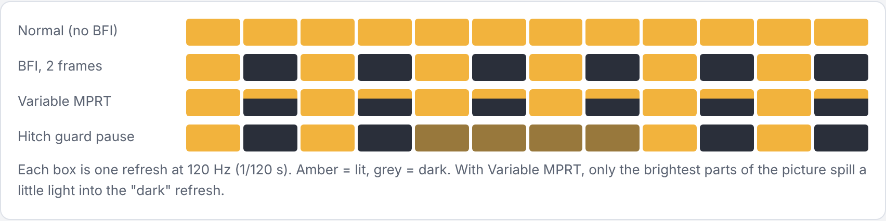
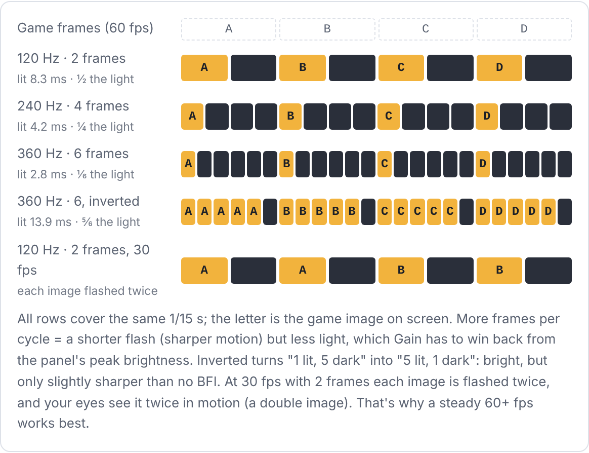
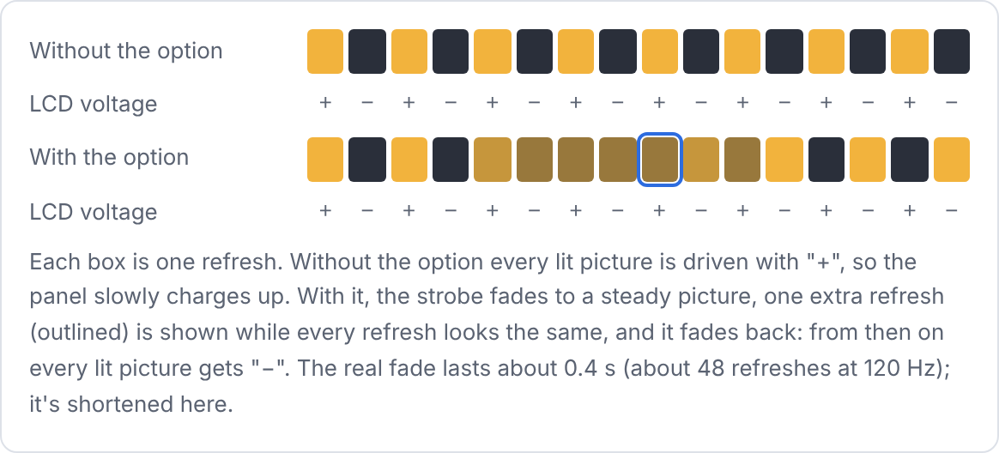
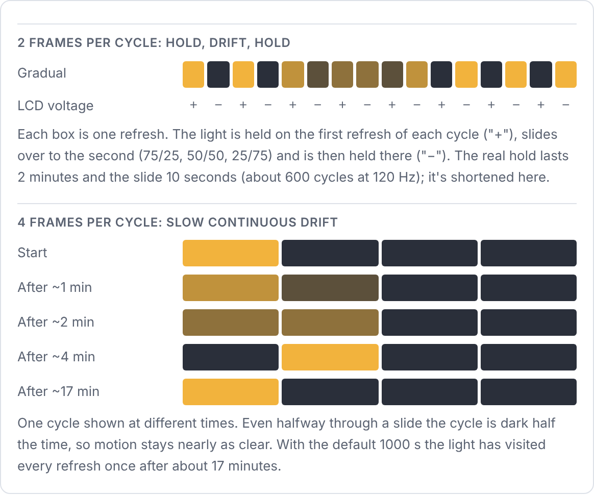
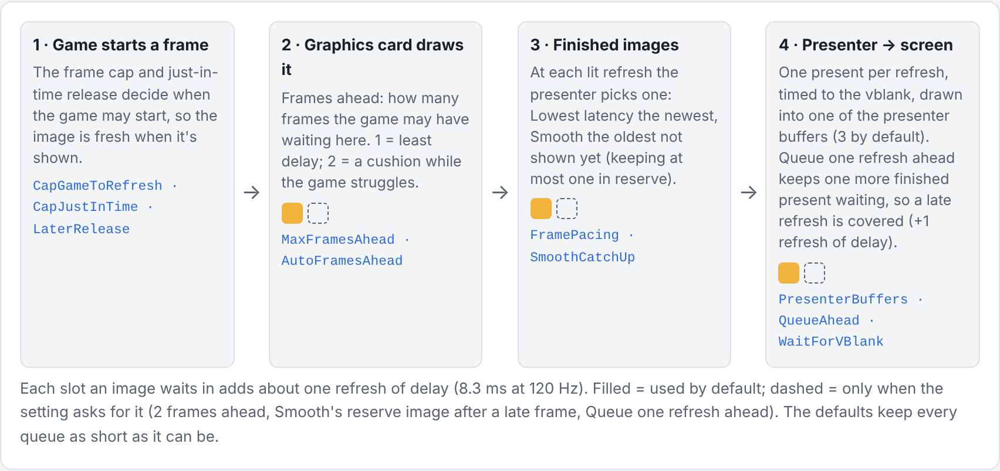
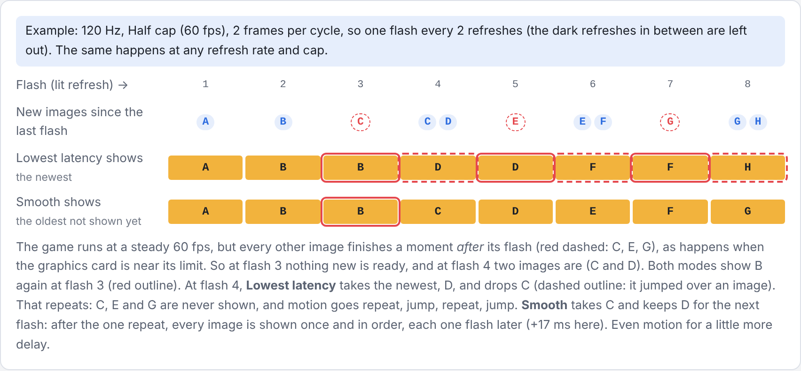
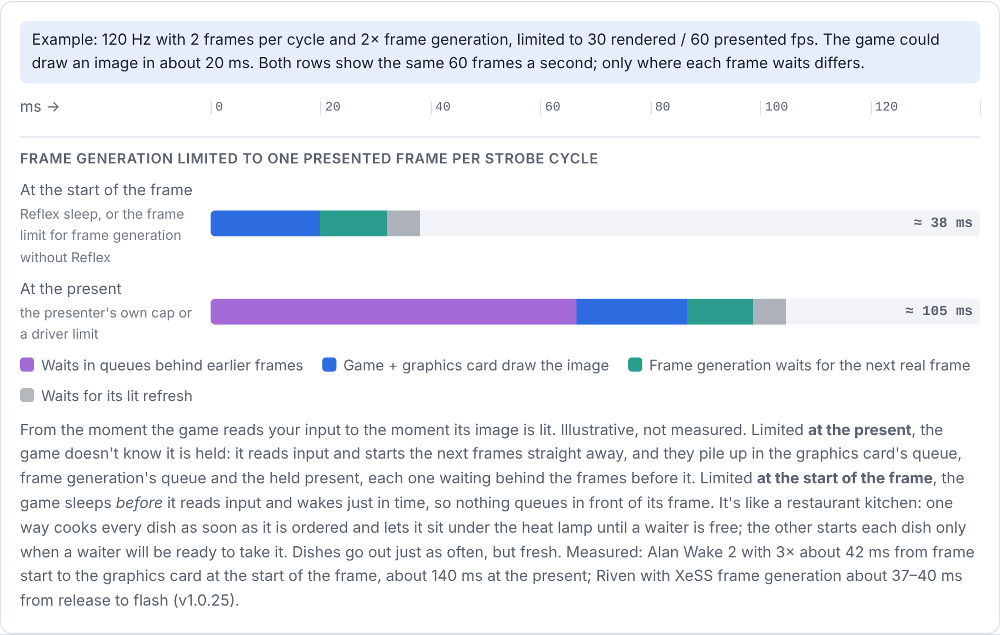

# BFI Presenter Settings Guide

What each option in the BFI Presenter window (and in `BFIPresenter.ini`) does, in plain words, for people who just want sharper motion and don't care how a GPU works. Each entry says what it is, what you'd notice, and when it's worth touching. Most people only ever need the first two sections.

**Contents:** [The idea in one minute](#the-idea-in-one-minute) · [The strobe](#the-strobe) · [Rolling scan](#rolling-scan) · [Your display](#your-display) · [Smoothness and latency](#smoothness-and-latency) · [Safety nets](#safety-nets) · [Compatibility switches](#compatibility-switches) · [Vulkan only](#vulkan-only) · [Logs](#logs) · [Hotkeys](#hotkeys) · [Good starting points](#good-starting-points)

Each entry shows the setting's name in the overlay, its key in `BFIPresenter.ini` and its default.

## The idea in one minute

An OLED or LCD keeps each picture lit for the whole time until the next one arrives. Your eyes follow moving things smoothly, but the picture on screen jumps in steps, so everything in motion smears. CRT displays didn't have this problem because each picture only flashed briefly.

BFI Presenter brings the flash back. At 120 Hz your screen shows 120 pictures a second; BFI Presenter makes one of them bright and the next one dark, over and over. The game still shows 60 new images a second, but each one is only visible for half the time, so motion looks about twice as sharp. The price is brightness (half the light) and a 60 Hz flicker some people notice.

<picture>
  <source media="(prefers-color-scheme: dark)" srcset="img/bfi-refreshes-dark.png">
  
</picture>

Everything below is a way of tuning that flash: how bright it is, how it handles highlights, and how BFI Presenter keeps the game in step with it.

## The strobe

**BFI enabled** · `Enabled` · default: on\
The main switch. Off, BFI Presenter still shows the game but without any dark frames, so you can compare.\
*When to change it:* use the hotkey Ctrl+Shift+B to flip it during play and see the difference.

**Method** · `Method` · default: Variable MPRT
- **BFI** makes the dark refresh truly black. Sharpest motion, but the picture loses half its light, and very bright areas have nowhere to go, so they get gently squashed.
- **Variable MPRT** works like a brightness budget: dark and mid-tones flash exactly like BFI, but anything too bright to fit in one flash borrows a bit of the dark refresh. You keep bright highlights at the cost of slightly less sharpness in only those bright parts. Think of it as "BFI where it's free, a little less where it would cost you brightness."

*When to change it:* Variable MPRT is the better default, especially in HDR. Try BFI if you want the crispest possible motion and don't mind a dimmer picture. Hotkey: Ctrl+Shift+M.

**Frames per cycle** · `Frames` · default: 2\
How many refreshes make up one flash cycle: 2 means "one lit, one dark". 3 or 4 means one lit and two or three dark, which is even sharper but darker, and flickers at a lower rate.\
*When to change it:* keep 2 at 120 Hz. Higher values are for 240 Hz+ displays; pair them with the **One game frame per strobe cycle** frame cap, so each game image gets exactly one flash.

> **The formula:** strobe rate = your refresh rate ÷ frames per cycle. For a new image on every flash, the game needs at least that many fps. With frame generation, count the **final** fps, generated frames included: the presenter sees every presented frame the same way.
> E.g. 120 Hz ÷ 2 = 60 fps · 240 Hz ÷ 2 = 120 fps (e.g. 60 real ×2 frame generation, or 40 real ×3) · 360 Hz ÷ 6 = 60 fps.
> Prefer a higher frame-generation factor over more frames per cycle: e.g. at 240 Hz, 40 real ×3 at 2 frames (a 120 Hz strobe) beats 40 real ×2 at 3 frames (an 80 Hz strobe, more flicker).

<picture>
  <source media="(prefers-color-scheme: dark)" srcset="img/frames-per-cycle-dark.png">
  
</picture>

**Gain vs blur** · `Gain` · default: 0.5 (recommended 1.0)\
How much of the lost brightness to win back. At 0.5 the lit frame looks exactly like the normal picture, so the overall image is half as bright. At 1.0 the lit frame is boosted to make up the difference, so the average brightness is close to normal.\
*When to change it:* use 1.0 on bright displays (most OLEDs in HDR). With the **ABL guard** on and its budget set to your panel's full-white brightness, bright scenes stay steady at 1.0. Lower it only if the screen still dims in bright scenes (ABL guard off, or its budget set too high), or in SDR, where there is little room above white and bright highlights get compressed and look flat.

**Dark frame floor** · `DarkFloor` · default: 0\
How dark the dark refresh is. 0 is pure black. Raising it leaves a faint copy of the picture in the dark refresh: less flicker, a bit more blur.\
*When to change it:* raise to 0.05–0.15 only if the flicker bothers you.

**Highlight roll-off** and **knee** · `HighlightRolloff`, `RolloffKnee` · default: on, 0.75\
BFI method only. When the boosted lit frame can't get any brighter, the brightest areas would clip into flat white blobs and shift colour. Roll-off eases them in smoothly instead, keeping their colour. The knee is where the easing starts: lower means it starts earlier and is gentler.\
*When to change it:* leave it on. Lower the knee a little if bright skies or lamps look flat.

**Sine BFI** · `SineBFI` · default: off\
Instead of a hard on/off, the brightness rises and falls in a soft wave across the cycle. Softer flicker, slightly more blur. Mostly useful with 3 or more frames per cycle.

**Invert cycle** · `InvertCycle` · default: off\
With 3+ frames per cycle, flips the pattern to "lit, lit, dark" instead of "lit, dark, dark". Brighter and less flicker, less sharpness gain. Does nothing at 2 frames.

## Rolling scan

A CRT didn't flash the whole screen at once: a beam drew it line by line from top to bottom. Rolling scan imitates that by lighting the screen in horizontal bands, one after another.

**Rolling scan** · `RollingScan` · default: off\
Lights the screen band by band instead of all at once. Because part of the screen is always lit, the flicker feels much calmer.\
*When to change it:* really meant for 240 Hz+ displays (4 bands). At 120 Hz there are only two halves, with a visible seam in the middle. Hotkey: Ctrl+Shift+S.

**Seam** · `RollingSeam` · default: 0 (hard edge)\
Only with phosphor decay at 0. How wide the blended zone is where two bands meet, as a share of the screen height. Wider hides the edge better, but pixels in the zone are lit in both bands' refreshes, so the seam blurs visibly in motion.\
*When to change it:* rarely; maybe in a very static game. Phosphor decay hides the edge without that blur.

**Phosphor decay** · `RollingPhosphorDecay` · default: 0.2\
Makes each line fade out after the "beam" passes, like the glow of a real CRT, instead of switching off sharply. No seam at all, smoother and less flickery, slightly more blur.\
*When to change it:* 0.2–0.4 works well; 0 switches it off and gives hard bands with the seam above.

## Your display

**LCD: prevent image retention** · `LcdPhaseSwap` · default: off\
**Turn this on if you have an LCD monitor (IPS, VA or TN).** An LCD drives every refresh with the opposite voltage of the one before, so over time it all evens out. With BFI's "lit, dark, lit, dark" every lit picture lands on the same voltage, and after a long session the screen can keep a faint ghost of the image (HUDs, menus). It's usually temporary, but annoying. The fix is to move the lit picture to the other refresh from time to time, so the lit pictures get the other voltage for a while and it evens out. There are two ways to do that, picked with **Mode**.\
*When to change it:* on for every LCD; leave off for OLED, which doesn't work this way. Not needed with an odd number of frames per cycle (3, 5, 7), where the lit refresh alternates anyway.

**Mode** · `LcdSaverGradual` · default: Immediate (0)\
How the lit picture is moved to the other refresh.

- **Immediate** (0): every few seconds the flashing fades out to a steady picture (about half a second), shifts by one refresh where nobody can see it, and fades back in. Quick and well tested, but each swap shows as a short softening of motion, and some people notice a small stutter.
- **Gradual** (1): the lit picture slides slowly from one refresh into the next instead of jumping, with no fade and no stutter. How it slides depends on the frames per cycle, below.

*When to change it:* try Gradual if the Immediate swaps bother you. Gradual works with the plain strobe (BFI or Variable MPRT) only; with Sine BFI, Invert cycle or Rolling scan on, Immediate is used.

**Immediate: seconds between swaps** · `LcdPhaseSwapSeconds` · default: 5\
How long the full strobe runs between two swaps (1–300).\
*When to change it:* lower it if you still see a ghost. One IPS tester still saw one at 30 s; at 5 s it was gone.

<picture>
  <source media="(prefers-color-scheme: dark)" srcset="img/lcd-phase-swap-dark.png">
  
</picture>

**How Gradual moves the light.** Think of each refresh in a cycle as a chair, and the lit picture as a spotlight on one chair. Gradual slides the spotlight to the next chair instead of switching it off and on again. While it slides, part of the light is on one refresh and the rest on the next; the total light in the cycle never changes, so nothing flickers or changes brightness.

The catch is that while the light is split, the picture is lit for longer, and longer means more motion blur. How much depends on how many refreshes the cycle has:

- **2 frames per cycle (e.g. 60 fps at 120 Hz):** halfway through a slide the light is split 50/50 over both refreshes. That's the same as no BFI at all for that moment, so motion clearly softens. So at 2 frames Gradual **holds, drifts, holds**: the light stays fully on one refresh for 2 minutes (sharp, just like with the option off), slides to the other refresh over 10 seconds, and stays there for the next 2 minutes. You're in a slide only about 8% of the time, and noticeably soft for about half of that.
- **4 or more frames per cycle (e.g. 60 fps at 240 Hz):** halfway through a slide the cycle is still something like 50%, 50%, 0%, 0%, so it's dark half the time and motion stays nearly as clear. Here Gradual slides **continuously and very slowly**: by default once through the whole cycle every 1000 seconds (about 17 minutes), about 4 minutes per refresh. Changes that slow are very hard to see.

<picture>
  <source media="(prefers-color-scheme: dark)" srcset="img/lcd-gradual-dark.png">
  
</picture>

**Gradual at 2 frames: hold seconds** · `LcdGradualHoldSeconds` · default: 120\
How long the light stays fully on one refresh before it slides to the other (0–600). 0 = no holds: slide continuously, using the seconds per full drift below.\
*When to change it:* if you see a ghost image, lower it (e.g. 30, or 20 for a very sensitive panel). Each hold puts the lit pictures on one voltage, like the time between Immediate swaps, and one IPS tester saw a ghost with Immediate swaps every 30 s. Shorter holds mean slides come more often.

**Gradual at 2 frames: drift seconds** · `LcdGradualDriftSeconds` · default: 10\
How long one slide to the other refresh takes (2–60).\
*When to change it:* longer (20–30) if you notice the slide as a change in clarity; it becomes gentler, but the picture is soft for longer. Shorter gets it over with, but the change becomes easier to see.

**Gradual at 4+ frames: seconds per full drift** · `LcdGradualSeconds` · default: 1000\
How long the light takes to slide once through every refresh of the cycle (20–1200). Also used at 2 frames when hold seconds is 0.\
*When to change it:* rarely. 1000 s is the default of the Blur Busters CRT simulator, which this mode follows; 100 s is very cautious and mainly makes the changes easier to see. Ini files from the first test builds may still have 120: set it to 1000.

*Gradual follows the LCD Saver of the [Blur Busters](https://blurbusters.com) CRT beam simulator by Mark Rejhon and Timothy Lottes, written from scratch for BFI Presenter. Testing on high-refresh LCDs is still welcome: tell me what you see.*

**Output** · `Output` · default: auto\
Whether the game's picture is SDR or HDR (and which HDR format). Auto reads it from the game.\
*When to change it:* leave on auto. Only force it if colours look obviously wrong.

**Display peak** · `DisplayPeakNits` · default: 1400\
The brightest your screen can get, in nits. In HDR, the boosted lit frame never asks for more than this.\
*When to change it:* set it to your display's real peak brightness (check a review such as RTINGS). Too high and highlights clip; too low and you waste brightness.

**ABL guard** and **budget** · `AblGuard`, `AblGuardBudgetNits` · default: on, 250\
OLED screens have a power limit: when a lot of the screen is bright at once, the TV dims everything (that's "ABL"). With BFI the lit frame is extra bright, so that limit can kick in and make bright scenes pump or flash. The guard watches how much bright area is on screen and gently lowers the boost in very bright scenes, so the TV never hits its limit. It knows that a panel holds more brightness on a small area than on the whole screen: by default it assumes your **Peak brightness** on 10% of the screen, falling to the budget on all of it (v1.0.20).\
*When to change it:* set the budget to your screen's full-white brightness: about 250 for the Sony A95L and similar QD-OLEDs, 150–200 for many LG-panel OLEDs. If a review lists your panel's sustained brightness by window size, enter it as `AblCurve` in the ini (e.g. `AblCurve=10:1400,25:600,50:400,100:250`).

## Smoothness and latency

BFI only looks right if every new game image lands exactly on a lit refresh. These settings decide how BFI Presenter paces the game to make that happen, and how much input delay you trade for smoothness.

<picture>
  <source media="(prefers-color-scheme: dark)" srcset="img/frame-pipeline-dark.png">
  
</picture>

<picture>
  <source media="(prefers-color-scheme: dark)" srcset="img/frame-pacing-dark.png">
  
</picture>

**Game frame cap** · `CapGameToRefresh` · default: Refresh rate\
Limits how fast the game runs so it stays in step with the flashing.
- **Refresh rate** (the full refresh rate, e.g. 120 fps at 120 Hz): for games that easily hold 120.
- **Half refresh** (half the refresh rate, e.g. 60 fps at 120 Hz): for games that can't hold 120. Every game image gets exactly one flash, which is the smoothest look.
- **Quarter** (a quarter of the refresh rate, e.g. 30 fps at 120 Hz): for very heavy games; each image is flashed twice, evenly.
- **One game frame per strobe cycle**: the refresh rate divided by Frames per cycle. Made for fast displays with longer cycles: 60 fps at 360 Hz with 6 frames, 90 fps at 360 Hz with 4, 80 fps at 240 Hz with 3. Each game image gets exactly one flash.
- **Custom** (`CapDivisor`): a new game image every N refreshes (1–8). Pick a multiple of Frames per cycle, or some images start on a dark refresh and motion judders; the overlay warns when it doesn't fit.
- **Off**: no limit (not recommended).

*When to change it:* leave it at Refresh and let the automatic frame cap (below) step down when the game can't keep up. Pick Half yourself if you'd rather it stays at 60 fps. With frame generation (DLSS FG, FSR FG, Lossless Scaling) use Refresh with the automatic frame cap: in Reflex games it steps down with Reflex's frame limit, quicker than Half refresh since v1.0.19 even when the output is only about the strobe rate (Alan Wake 2 with 3×: about 42 ms from frame start to the GPU against about 140 ms). Without Reflex, when the output is only about the strobe rate (e.g. 60 at 120 Hz: 2× at about 30 rendered fps, 3× at about 20), Half refresh + Smooth shows every generated frame.

**Automatic frame cap** · `AutoFrameCap` · default: on · needs the Refresh rate cap\
When the game can't hold the refresh rate (e.g. 90 fps at 120 Hz), some images are shown twice and others skipped, which judders. The automatic frame cap then steps down to one game frame per strobe cycle (e.g. 60 fps at 120 Hz with 2 frames per cycle), so every flash shows the next image, and goes back to Refresh once the game has headroom again.

How it caps depends on the game:

- **No Reflex, no frame generation:** the presenter's own cap. The game is held right after its present, before it starts its next frame, at a start time tried out across the strobe cycle (**Hold at the frame start**, below).
- **DirectX with NVIDIA Reflex** (every DLSS frame-generation game): Reflex's frame limit, one presented frame per strobe cycle (e.g. 60 at 120 Hz), with frame generation or without. The game and its generated frames are paced at the start of each frame. Tick **Presenter's own cap without frame generation** (`AutoCapOwnWithoutFg=1`) to use the presenter's cap while frame generation is off; it follows frame generation being switched on and off.
- **DirectX, frame generation without Reflex** (e.g. XeSS frame generation through OptiScaler): stays at Refresh; **Frame limit for frame generation without Reflex** (below) limits it instead (v1.0.25).
- **Vulkan with Reflex and frame generation** (v1.0.23): Reflex's frame limit as in DirectX, but only while that leaves about 30 rendered fps or more: 2× at 120 Hz (30 rendered, 60 presented) is capped, 3× (20 rendered) stays at Refresh, where it lagged and presented unevenly (Indiana Jones).
- **Vulkan, frame generation without Reflex:** stays at Refresh, so aim for a final fps (generated frames included) close to your refresh rate. The layer recognises it by its loaded DLL; for games that load one without using it, see `FrameGenDllCheck` under Vulkan only.

Back to Refresh:

- **Games with Reflex** report how long their frames take; the cap goes back up once those fit well within a refresh for 10 seconds.
- **Other games:** it tries Refresh for about 3 seconds, after 30 s, then 60 s, then every 2 minutes while the game still can't hold it. A game well under the refresh rate (under 80%, e.g. 80 fps at 120 Hz) waits a minute before its first try and 5 minutes after a failed one, since each try is a few seconds of uneven frames; a game that drops back within 30 s of a successful try waits twice as long next time (v1.0.27).
- **With frame generation** under Reflex's limit it tries only every 5 minutes, since each try is a visible stutter.

Reflex's limit is applied by the presenter in the game's own Reflex sleep call (since v1.0.19), because the driver's limit counts the presenter's own presents and some games collapsed under it to about 7 fps (The Witcher 3, Returnal, Pragmata). Games that call their Reflex sleep more than once per frame (DLSS 5 injectors with frame generation in Onimusha) keep the driver's limit. If a game still falls far below the limit, the presenter drops it for the rest of the session and uses its own cap.\
*When to change it:* leave on. Turn off if you'd rather keep 120 fps with some judder when the game dips.

Why the limit is applied at the start of the frame (the game's Reflex sleep, or right after its own present without Reflex) and not at the present:

<picture>
  <source media="(prefers-color-scheme: dark)" srcset="img/frame-limit-fg-dark.png">
  
</picture>

**Hold at the frame start** · `AutoCapAtFrameStart` · default: on · games without Reflex (or with **Presenter's own cap without frame generation**), Lowest latency pacing\
When the automatic frame cap steps down to one game frame per strobe cycle, the game is held right after its present, before it reads input for the next frame, instead of its finished frame waiting at the present. The moment it is let go matters: let go too early, the finished frame waits for its flash; too late, it misses it. So the presenter tries 8 start times across one strobe cycle (about 24 seconds) and keeps the one where every frame is shown soonest, with about 3 ms to spare. It keeps that start time while the cap tries Refresh and comes back, and looks again after a few seconds of lost frames. It looks only while the game holds the cap, not in scenes too heavy for it. Results from frame start to flash at 60 of 120 Hz (v1.0.27): Tomb Raider about 19 ms against 25 ms with the old cap, Obduction 23 against 25, No Rest for the Wicked 19 against 23, Resident Evil 4 about 27 against about 30.\
**Vulkan:** the layer already held the game before its next frame, at the refresh before the lit one. Now it tries start times the same way when frames wait 3 ms or more for their flash, and keeps one only if it is at least 1 ms quicker (P.T.-PC: 19 ms from release to flash against 25 ms). Games that pace themselves gain less (about 4 ms in DriveClub-PC). Emulated NTSC games run at 59.94 fps, a little slower than a 60 Hz strobe, so their frames slide through the strobe cycle and one flash repeats about every 17 seconds; the layer then leaves the start time alone, and the log suggests a display mode of 119.88 Hz, which matches them exactly (PCSX2: no repeats and a steady 19 ms from release to flash at 119.88 Hz, against a repeat every 17 seconds at 120 Hz; the emulator's own sync options made no difference). To switch automatically, start the emulator from a batch file that uses [NirCmd](https://www.nirsoft.net/utils/nircmd.html): `nircmd setdisplay 3840 2160 32 119` before it and `nircmd setdisplay 3840 2160 32 120` after it. Windows lists 119.88 Hz as 119 there; use your own resolution.\
*When to change it:* leave on. The overlay shows the search and the start time in use.

**Remember per game** · `LearnPerGame` · default: on\
What the automatic frame cap finds for a game is saved in `BFIPresenter_learned.ini` next to `BFIPresenter.ini`: whether it holds the game to one frame per strobe cycle, and the frame start time (or that the game doesn't need one). The next time you play, it starts from there, so the first minute is no longer seconds of uneven frames followed by a 24-second search. Each game of an emulator is kept separately, by its window title (digits such as fps counters and version numbers are left out). Only used at the same refresh rate and frames per strobe cycle. What it remembers is still checked as usual: tries at Refresh rate (the first after a minute) and a new search after a few seconds of lost frames, and the file is updated when something changes.\
*When to change it:* leave on. **Forget this game** next to it deletes what was remembered for the game you're playing and starts over right away (the cap goes back to Refresh rate and steps down again if needed, and the frame start is searched for again), e.g. after changing the game's graphics settings a lot or the display mode. Deleting `BFIPresenter_learned.ini` forgets every game.

**Frame pacing** · `FramePacing` · default: Lowest latency (new ini files)
- **Lowest latency** always shows the newest image: quickest response.
- **Smooth** holds one finished image in reserve so every image is shown once, in order, even if one arrives a little late: about one refresh more delay.

*When to change it:* leave on Lowest latency. Smooth only helps at the Half or Quarter cap in games whose frame time varies so much that just-in-time release keeps hitting its limit (the overlay's status line shows it). An ini file from an earlier version keeps its own setting: change it in the overlay and save.

**Smooth: catch up after a hitch** · `SmoothCatchUp` · default: off\
After a stutter, Smooth mode can skip one frame to get back to the lowest delay. That makes a second small stutter right after the first. Off means it stays one frame behind instead and keeps motion even.\
*When to change it:* leave off. Turn on only if you prefer lower delay over perfectly even motion.

**Just-in-time release** · `CapJustInTime` · default: on\
With any cap below the refresh rate (Half, Quarter, one frame per strobe cycle, Custom), BFI Presenter learns how long the game takes to draw a frame and tells it to start at exactly the right moment, so each frame finishes just before its flash. Even motion, no waiting around.\
*When to change it:* leave on.

**Apply the cap with Reflex's frame limit** · `CapWithReflex` · default: off · DirectX games with NVIDIA Reflex\
With Half, Quarter or another cap below the refresh rate, the cap is applied by Reflex's own frame limit (what a game's own Reflex fps limit does) instead of just-in-time release. A few engines hand their frames over so irregularly that just-in-time release keeps switching itself off and motion stutters even at a steady 60 fps; Reflex then paces the game evenly where it starts each frame (The Midnight Walk at Half: 1.7% of flashes off-cadence with it, 15.6% without).\
It costs latency: about 10–20 ms more than just-in-time release (Silent Hill 2 at Half: 34 ms against 25 ms from release to flash; Alan Wake 2 at Quarter: 56 ms against 35 ms), and in games where just-in-time release works it is no smoother. Games without Reflex keep the presenter's cap; the overlay shows whether the limit is in use.\
*When to change it:* leave off. Turn on only for a game that still stutters at Half or Quarter while the overlay shows just-in-time release switching off, and compare.

**Line Reflex's frame limit up with the flash** · `ReflexAlign` · default: off · DirectX games with NVIDIA Reflex, Lowest latency pacing, no frame generation\
Reflex's frame limit starts each game frame on its own clock, so a finished frame can wait up to a whole strobe cycle before the lit refresh shows it, and how long depends on the launch. With this on, BFI Presenter measures that wait and moves the start of each frame until frames are ready about 2 ms before their flash; if frames start missing it, it backs off. God of War Ragnarok: about 31 ms from release to flash every launch, against 31–44 ms depending on the launch. In games whose frame times vary a lot it gains little and can repeat a frame now and then (Spider-Man 2: 1.5 ms quicker, more repeats; Dead Space: no change).\
*When to change it:* turn on for Reflex games with steady frame times that hold the cap. The overlay shows how long frames wait before their flash.\
With it off, a coarser version runs by default (`ReflexAlignCoarse=1`, v1.0.27): when frames are ready more than 8 ms before their flash for 3 seconds, the start of each frame is moved later once, to about 5 ms before it. It acts again whenever the game's own timing drifts (each time Reflex's limit comes on, after hitches, as the GPU load changes), and backs off if frames start repeating. Dead Space: the lit frame's age went from a median 26.5 to 23.8 ms, with no more dropped frames.

**Frame limit for frame generation without Reflex** · `FrameGenLimitWithoutReflex` · default: on · DirectX games with frame generation but no NVIDIA Reflex, Refresh rate cap\
Frame generation in games without Reflex (e.g. XeSS frame generation through OptiScaler) gets no frame limit from the game, so it renders as fast as it can and the flashes get generated and real frames unevenly. With this on, BFI Presenter holds the game's own frames to one per strobe cycle × the frame-generation factor (e.g. 30 rendered and 60 presented at 120 Hz with 2 frames and 2×), right after each of its presents, and picks the moment each frame starts: for about 25 seconds after it comes on it tries start times across one strobe cycle and keeps the one where every frame reaches a flash soonest. It recognises frame generation because the generated frames are presented from a thread of their own; it is used only while that leaves about 28 rendered fps or more. Riven with XeSS frame generation: 60 of 60 flashes, about 38 ms from release to flash. FSR frame generation through OptiScaler presents every frame from a thread of its own; since v1.0.26 the presenter counts the game's frames on FSR's swap chain instead, where the game still presents once per rendered frame (`HookOuterSwapChain`, on by default). The Callisto Protocol with FSR: 60 of 60 flashes, about 28–34 ms; in Riven FSR's own timing moves against the flashes now and then (55 of 60 on average, against 46 with OptiScaler's 60 fps limit), and XeSS frame generation is steadier there.\
*When to change it:* leave on, with Lowest latency pacing, and turn off any frame limit in the game or in OptiScaler (`FramerateLimit = 0`). The limit only helps when the game renders at least the limit with frame generation on (e.g. 30 fps at 120 Hz with 2 frames and 2×); below it, frames are lost either way. The overlay shows the time per rendered frame while it is in use.

**Later release** and **margin** · `LaterRelease`, `LaterReleaseMarginMs` · default: off, 1.5 ms\
The same trick for the Refresh cap with Lowest latency: the game starts each frame as late as safely possible, which cuts up to about 5 ms of input delay in light games. The margin is the safety gap it keeps (it grows by itself if frames start arriving late).\
*When to change it:* turn on for light games that hold 120 fps comfortably (Cuphead, indies). Not with frame generation.

**Frames ahead** and **automatic** · `MaxFramesAhead`, `AutoFramesAhead` · default: 1, automatic on\
How many finished frames the game may line up before they're shown. Like a queue at a counter: 1 means you're always served next (least delay), 2 gives a buffer if the game is struggling. Automatic picks 1 normally and switches to 2 only while the game keeps missing its slot.\
*When to change it:* leave automatic on.

**Wait for vblank** · `WaitForVBlank` · default: on\
"Vblank" is the moment the screen starts a new refresh. BFI Presenter waits for it before sending each flash, which keeps the flashes perfectly in time with the screen.\
*When to change it:* leave on.

**Presenter buffers** · `PresenterBuffers` · default: 3\
How many picture slots BFI Presenter uses to hand flashes to the screen. More slots give more slack, fewer give slightly less delay.\
*When to change it:* leave at 3.

**Queue one refresh ahead** · `QueueAhead` · default: off\
Keeps one finished flash ready in advance, so if the graphics card is briefly too busy, the screen still gets its flash on time. Costs one refresh (about 8 ms at 120 Hz) of delay.\
*When to change it:* turn on only if you see single bright or dark flashes in very GPU-heavy games, or if G-SYNC keeps sneaking in.

## Safety nets

**Hitch guard** · `HitchGuard`, `HitchGuardLoadingMs` · default: on, 1000 ms\
When the game freezes for a moment (loading screens, big stutters), a lit or dark frame would be held too long and you'd see a flash. The hitch guard notices and shows a steady, evenly bright picture until things settle, then resumes BFI after a second. Motion is less sharp during the pause, but nothing flashes.\
*When to change it:* leave on. The loading time (1000 ms) is how long the game may stop sending new pictures before it counts as a loading screen.

**Flash hints** · `FlashHints` · default: on\
When the strobe keeps flashing (refreshes missed in 3 of 10 seconds; loading screens don't count), the status box at the top of the overlay suggests what to try next, one step at a time: start Steam or the game's launcher as administrator for a realtime GPU queue (DirectX), 4 presenter buffers, Queue one refresh ahead (+1 refresh of latency), and if it still flashes, lighter game settings or the Half refresh cap. The buttons apply and save the step for this game; nothing changes unless you click. The hint goes away after 30 seconds without flashes.\
*When to change it:* **Hide flash hints** turns them off for this game if you accept the odd flash.

**Allow RivaTuner** · `AllowRTSS` · default: on\
Lets BFI Presenter run when RivaTuner (the frame counter / limiter tool) is active. Its frame limiter must be off for BFI games, or it causes flashes.

## Compatibility switches

These exist to make specific games work. The defaults are right for nearly everyone; the [tested-games list](tested-games.md) says when a game needs one changed.

**Own GPU queue** · `PresentOnOwnQueue` · default: on\
BFI Presenter sends its flashes on a separate lane of the graphics card, so a busy game can't hold them up.

**Queue priority** · `PresenterQueuePriority` · default: 2 (realtime)\
How urgently the graphics card treats the flashes. Realtime needs the game (or Steam) started as administrator; otherwise it falls back to high.\
*When to change it:* lower to 1 or 0 only if a game freezes with BFI Presenter.

**Start BFI after the game resizes** · `StartBFIAfterGameResize`, `WaitForResizeOnRecreatedSwapChain` · default: on\
BFI starts once the game has finished setting up its window (almost every game does this at launch). This avoids freezes in a few games.\
*When to change it:* if BFI doesn't start, change resolution or display mode once in the game.

**Report the game's own frames** · `GameFrameStatistics` · default: on\
Games that measure their own frame rate see their real frames, not BFI Presenter's 120 flashes, so their in-game FPS counters and pacing stay correct.

**Reuse drawn buffers** · `ReuseDrawnBuffers` · default: on\
If the next flash would be identical to one already prepared, it's reused instead of drawn again. Less work for the graphics card, steadier timing.

**Bypass overlay hooks** · `BypassOverlayResizeHooks` · default: on\
Overlays like Steam's or RivaTuner's don't draw on the flashed frames. This prevented hangs in some games.

**Show overlays** · `ShowOverlays` · default: off\
Lets RivaTuner's on-screen display (fps counter) and the Steam overlay draw on the picture you see, in 64-bit DirectX games. Normally they're skipped, because Steam's overlay crashed a few games when the flashed frames went through it. It does nothing in 32-bit games (they crashed or still showed nothing) and OpenGL games.\
*When to change it:* turn it on if you want the RTSS OSD in a DirectX game, and off again if the game then crashes or hangs. Keep RivaTuner's frame limiter off. It takes effect the next time you start the game. Vulkan games show the OSD without it.

**DirectX 11 / 9 / OpenGL support** · `DX11Support`, `DX9Support`, `OpenGLSupport` · default: on\
Lets the add-on handle older games. They're shown through BFI Presenter's own window over the game, so these games need borderless or windowed mode (it switches them automatically).

**Borderless fullscreen** · `BorderlessFullscreen` · default: on\
For those older games: turns the game's window into a borderless full-screen one, since true exclusive fullscreen doesn't work with BFI Presenter's window.

**Let the DX11 game present too** · `DX11GamePresent` · default: off\
A fix for a few DX11 games that slow down over time while BFI runs (Wreckfest).

**OpenGL: don't wait for vblank** · `OpenGLSwapInterval0` · default: on\
OpenGL games are told not to wait for the screen themselves, since BFI Presenter does the waiting.

**Typed buffer description** · `TypedBackBufferDesc` · default: on\
A technical detail some games check (The Last of Us Part I crashed without it). Leave on.

## Vulkan only

**Vulkan layer** · `VulkanLayer` · default: on\
For Vulkan games and emulators: having `BFIPresenter.ini` next to the game turns BFI on. This setting switches it off for that game without deleting the file.

**Own queue** · `VulkanOwnQueue` · default: on\
Same idea as the DirectX "own GPU queue": the flashes get their own lane.

**Exclusive fullscreen** · `VulkanExclusiveFullscreen` · default: on\
The presenter's own output runs in exclusive fullscreen; the game's window mode stays as you set it. Without it, opening an overlay (RivaTuner's OSD, ReShade's menu) or alt-tabbing could hand the picture over to Windows' desktop compositor, where the flashes lose their timing and flicker until the game restarts.\
*When to change it:* only if a game misbehaves with it; it applies at the next game start.

**Recover automatically** · `VulkanAutoRecover` · default: on\
Some things can still put Windows into that slower mode, and it stays there after they're gone: a window briefly covering the game (a launcher's splash screen) or the ReShade menu. When the presenter sees it for 5 seconds, it has the game rebuild its swap chain, which brings the flashes back in step. That's a short pause (in most games a blink; up to a few seconds in heavy ones), at most every 20 seconds. If presentation slows again soon after, the game is probably just using the whole GPU, which a rebuild can't fix: the next one waits longer (40, then 80 seconds), and after 3 such rebuilds it stops for the session. Slow moments while the automatic frame cap tries Refresh don't count. Ctrl+Shift+O does it by hand.\
*Tip:* in Vulkan games, change settings in `BFIPresenter.ini` rather than the ReShade menu while playing where you can; the game picks up the change within a second.

**SDR to HDR**, **SDR white**, **SDR highlights** · `SdrToHdr`, `SdrWhiteNits`, `SdrHighlightNits`, `SdrHighlightKnee` · default: on, 200, 800, 0.65\
For SDR games and emulators with Windows HDR on: the picture is sent as HDR so the lit flash has room to get brighter and BFI doesn't make the image dim. SDR white is how bright normal white looks (match Windows' "SDR content brightness"). Highlights optionally stretches the brightest parts toward a real HDR look.\
*When to change it:* set SDR white to taste; set highlights to 0 for a faithful SDR look.

**Frame generation DLL counts** · `FrameGenDllCheck` · default: on\
Games without NVIDIA Reflex don't tell the layer when frame generation is on, so a loaded frame-generation DLL (DLSS-G, FSR or XeSS frame generation) counts as on, and the automatic frame cap stays at Refresh. Some games and add-ons load one without using it (the RenoDX DLSS add-on loads DLSS-G's; DriveClub-PC). `BFIPresenterVK.log` names the DLL.\
*When to change it:* set to 0 (in the ini) for a game where the log names a frame-generation DLL but frame generation is off, so the automatic frame cap works. Leave it on wherever you do use frame generation.

Without ReShade, edit `BFIPresenter.ini` and save: Vulkan games pick up the change within a second.

## Logs

**Timing log** · `Log` · default: off\
Writes a detailed timing file while you play. Only useful when reporting a problem.

**Diagnostics** and **crash log** · `Diagnostics`, `CrashLog` · default: 1, on\
If a game crashes, these write a short report of what went wrong (`BFIPresenter_crash.txt` and friends). Tiny overhead; leave on, and send the files along with a bug report.

## Hotkeys

| Keys | Does |
|---|---|
| Ctrl+Shift+B | BFI on / off |
| Ctrl+Shift+M | Switch BFI ↔ Variable MPRT |
| Ctrl+Shift+S | Rolling scan on / off |
| Ctrl+Shift+R | Reload `BFIPresenter.ini` after editing it |
| Ctrl+Shift+O | Vulkan: rebuild the swap chain (if flashes started after an overlay or menu) |
| Ctrl+Shift+K | Put a marker in the log with the last second's state (frame rate, frame generation, Reflex limit, video memory), to find a moment you noticed when sending a log |

## Good starting points

| Situation | Settings |
|---|---|
| The game holds 120 fps | Frame cap: Refresh rate · Pacing: Lowest latency · Light game: Later release on · Gain 1.0, Variable MPRT |
| The game can't hold 120 | Frame cap: Refresh rate with Automatic frame cap on (it steps down to 60 by itself), or Half refresh · Pacing: Lowest latency · Just-in-time release on |
| Stutter at Half or Quarter while the overlay shows just-in-time release switching off (e.g. The Midnight Walk) | DirectX games with Reflex: Apply the cap with Reflex's frame limit on · Pacing: Lowest latency · Costs about 10–20 ms, so compare and keep it off where just-in-time release works |
| Frame generation, output about the strobe rate (e.g. 3× at 20 fps, 2× at 30) | Reflex games: Frame cap Refresh rate + automatic frame cap (Alan Wake 2 with 3×: \~42 ms from frame start to the GPU against \~140 ms at Half refresh). Without Reflex: Refresh rate (the DirectX add-on limits it with the frame limit for frame generation without Reflex), or Half refresh · Pacing: Smooth |
| Frame generation, output well above the strobe rate | Frame cap: Refresh rate · Automatic frame cap on (Reflex games: sets the Reflex frame limit; Vulkan only when it leaves ~30 rendered fps, e.g. 2× at 120 Hz) · Pacing: Lowest latency · Later release off · Final fps (generated frames included) at least refresh ÷ frames per cycle |
| Before anything else | G-SYNC / VRR off for the game, VSync on or "app setting" · No frame limiter (RivaTuner, NVIDIA) on the game · CRT shader: set its own decay off |

---

Defaults shown are the ones in `BFIPresenter.ini`. Gain ships at 0.5 (no change in the lit frame); 1.0 is the recommended setting on bright displays. Strobing flickers at 60 Hz by design; if you are sensitive to flicker or flashing images, take care and use Ctrl+Shift+B to turn it off.
